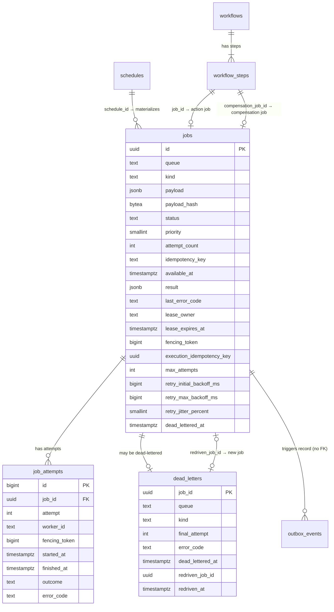

# TaskForge data model (schema v6)

PostgreSQL is the only durable store. The schema is defined by the embedded
migrations in [`db/migrations`](../db/migrations) and applied by
`taskforge-migrate` using goose. This document describes the schema after
migration `000006`.

## Entity relationships

## `jobs`

| Column | Type | Constraints / default | Purpose |
| --- | --- | --- | --- |
| `id` | `UUID` | PK | Generated by the application. |
| `queue` | `TEXT` | — | Validated as `^[a-z0-9][a-z0-9._-]{0,63}$`; default `default`. |
| `kind` | `TEXT` | — | Handler identifier, same pattern as queue. |
| `payload` | `JSONB` | must be an object | Canonicalized request payload. Sensitive. |
| `payload_hash` | `BYTEA` | exactly 32 bytes | SHA-256 submission fingerprint over queue, kind, payload, priority. |
| `status` | `TEXT` | `queued·running·succeeded·failed·canceled` | Current state. |
| `priority` | `SMALLINT` | `-100..100`, default 0 | Higher is claimed first. |
| `attempt_count` | `INTEGER` | `>= 0` | Incremented on each claim. |
| `idempotency_key` | `TEXT` | NULL or 1–128 chars | Client submission key, unique per queue. Sensitive. |
| `available_at` | `TIMESTAMPTZ` | default `NOW()` | Earliest claim time; pushed forward by retry backoff. |
| `result` | `JSONB` | nullable | Bounded handler result. Sensitive. |
| `last_error_code` | `TEXT` | `^[A-Z][A-Z0-9_]{0,63}$` | Most recent failure code. |
| `created_at`, `updated_at` | `TIMESTAMPTZ` | default `NOW()` | Audit timestamps. |
| `started_at` | `TIMESTAMPTZ` | nullable | Start of the most recent attempt. |
| `completed_at` | `TIMESTAMPTZ` | nullable | Set on terminal states. |
| `lease_owner` | `TEXT` | see lease check | Worker ID holding the lease. |
| `lease_expires_at` | `TIMESTAMPTZ` | see lease check | PostgreSQL-clock lease deadline. |
| `fencing_token` | `BIGINT` | `>= 0`, monotonic trigger | Incremented on each claim. |
| `execution_idempotency_key` | `UUID` | default `gen_random_uuid()` | Stable key passed to handlers; copied on redrive. Sensitive. |
| `max_attempts` | `INTEGER` | `1..100`, default 3 | Snapshotted retry policy (includes the first run). |
| `retry_initial_backoff_ms` | `BIGINT` | `1..86400000`, default 1000 | Snapshotted. |
| `retry_max_backoff_ms` | `BIGINT` | `>= initial`, `<= 86400000`, default 60000 | Snapshotted. |
| `retry_jitter_percent` | `SMALLINT` | `0..100`, default 20 | Snapshotted. |
| `dead_lettered_at` | `TIMESTAMPTZ` | nullable | Set when the job enters the DLQ. |
| `schedule_id` | `UUID` | nullable, FK → `schedules.id` `ON DELETE SET NULL` | Originating recurring schedule. |
| `scheduled_for` | `TIMESTAMPTZ` | non-NULL when `schedule_id` is non-NULL | Target cron slot time. |
| `workflow_id` | `UUID` | nullable, FK → `workflows.id` | Owning workflow. |
| `workflow_step_id` | `BIGINT` | nullable, FK → `workflow_steps.id` | Owning step. |
| `workflow_role` | `TEXT` | `action` or `compensation` | Which job of the step this is. |

### Invariants

- **Lease check (`jobs_lease_state_check`)**: `running` ⇔ `lease_owner` and
  `lease_expires_at` are both non-NULL. Every non-running row has no lease.
- **Monotonic fencing (`jobs_fencing_token_monotonic` trigger)**: an update
  that lowers `fencing_token` raises an exception.
- **Submission uniqueness (`jobs_idempotency_key_unique`)**: partial unique
  index on `(queue, idempotency_key) WHERE idempotency_key IS NOT NULL`.
- **Schedule slot uniqueness (`jobs_schedule_slot_unique`)**: partial unique
  index on `(schedule_id, scheduled_for) WHERE schedule_id IS NOT NULL`.
- **Workflow link (`jobs_workflow_link_check`)**: `workflow_id`,
  `workflow_step_id`, and `workflow_role` are all NULL or all set.
- **One job per step and role (`jobs_workflow_step_role_unique`)**: partial
  unique index on `(workflow_step_id, workflow_role)`; the database backstop
  for exactly-once dispatch.
- Jobs dispatched by the workflow engine have `created_at = clock_timestamp()`
  (insertion time), so they never appear to precede the dependency completion
  that released them.

## `job_attempts`

One row per claim. Rows are closed (never deleted) by success, failure, or
recovery.

| Column | Type | Constraints | Purpose |
| --- | --- | --- | --- |
| `id` | `BIGINT` identity | PK | Surrogate key. |
| `job_id` | `UUID` | FK → `jobs.id` `ON DELETE CASCADE` | Owning job. |
| `attempt` | `INTEGER` | `>= 1`, unique with `job_id` | Attempt number at claim time. |
| `worker_id` | `TEXT` | NOT NULL | Claiming worker. |
| `fencing_token` | `BIGINT` | `> 0` | Token of this ownership epoch. |
| `started_at` | `TIMESTAMPTZ` | NOT NULL | Claim time. |
| `finished_at` | `TIMESTAMPTZ` | nullable | NULL while the attempt is open. |
| `outcome` | `TEXT` | `succeeded·failed·abandoned` | Final attempt result. |
| `error_code` | `TEXT` | code pattern | Failure code, e.g. `LEASE_EXPIRED`. |

A job in `running` state always has exactly one open attempt
(`finished_at IS NULL`) whose `fencing_token` equals the job's token.

## `dead_letters`

| Column | Type | Constraints | Purpose |
| --- | --- | --- | --- |
| `job_id` | `UUID` | PK, FK → `jobs.id` | The terminally failed original job. |
| `queue`, `kind` | `TEXT` | NOT NULL | Copied for filtering without joining. |
| `final_attempt` | `INTEGER` | `>= 1` | Attempt number that failed last. |
| `error_code` | `TEXT` | code pattern | Final failure code. |
| `dead_lettered_at` | `TIMESTAMPTZ` | default `NOW()` | DLQ entry time. |
| `redriven_job_id` | `UUID` | UNIQUE, FK → `jobs.id` | New job created by redrive. |
| `redriven_at` | `TIMESTAMPTZ` | NULL iff `redriven_job_id` NULL | Redrive time. |

No payloads, results, or keys are stored here by design (ADR 0009).

## `schedules`

| Column | Type | Constraints | Purpose |
| --- | --- | --- | --- |
| `id` | `UUID` | PK | Schedule identifier. |
| `name` | `TEXT` | UNIQUE, `^[a-z0-9][a-z0-9._-]{0,63}$` | Human/operator schedule name and creation idempotency key. |
| `queue`, `kind` | `TEXT` | identifier pattern | Target queue and handler kind. |
| `payload` | `JSONB` | object | Canonicalized job payload template. Sensitive. |
| `payload_hash` | `BYTEA` | 32 bytes | SHA-256 creation fingerprint. |
| `priority` | `SMALLINT` | `-100..100`, default 0 | Job priority. |
| `cron_expr` | `TEXT` | 9–128 chars | Normalized 5-field cron expression. |
| `timezone` | `TEXT` | 1–64 chars, default `UTC` | IANA timezone name. |
| `paused` | `BOOLEAN` | default `FALSE` | Whether dispatch is paused. |
| `next_run_at` | `TIMESTAMPTZ` | NOT NULL | Next cron slot to materialize. |
| `last_run_at` | `TIMESTAMPTZ` | nullable | Most recently materialized slot. |
| `last_job_id` | `UUID` | nullable, FK → `jobs.id` `ON DELETE SET NULL` | Most recently materialized job. |
| `created_at`, `updated_at` | `TIMESTAMPTZ` | default `NOW()` | Audit timestamps. |

## `outbox_events`

Written only by the `taskforge_record_job_event()` trigger function, fired by
`jobs_record_insert_event` (`AFTER INSERT`) and `jobs_record_status_event`
(`AFTER UPDATE OF status`, only when the status changes). See
[EVENTS.md](EVENTS.md) for the published contract.

| Column | Type | Constraints | Purpose |
| --- | --- | --- | --- |
| `id` | `BIGINT` | identity PK | Event ID; per-job strictly increasing in transition order. |
| `job_id` | `UUID` | NOT NULL, **no FK** | Job the event describes; events may outlive job retention. |
| `event_type` | `TEXT` | one of six `job.*` types | Transition that occurred. |
| `payload` | `JSONB` | object | Privacy-safe job snapshot (no payload, result, keys, or owner). |
| `created_at` | `TIMESTAMPTZ` | default `NOW()` | Transition time (`occurred_at` on the wire). |
| `published_at` | `TIMESTAMPTZ` | nullable | Set by the relay after JetStream acknowledged the event. |

Invariants: an outbox row exists if and only if its transition committed;
rows with `published_at IS NULL` are never deleted.

## `workflows`

| Column | Type | Constraints | Purpose |
| --- | --- | --- | --- |
| `id` | `UUID` | PK | Workflow ID. |
| `label` | `TEXT` | NULL or 1–128 chars | Free-form client label. |
| `status` | `TEXT` | `running·compensating·succeeded·compensated·canceled·compensation_failed` | Current state. |
| `abort_reason` | `TEXT` | `step_failed·canceled`; NULL iff `running`/`succeeded` | Why the workflow is compensating. |
| `failed_step`, `error_code` | `TEXT` | code pattern | Step and failure code that aborted it. |
| `idempotency_key` | `TEXT` | UNIQUE, NULL or 1–128 chars | Global submission key. Sensitive. |
| `fingerprint` | `BYTEA` | 32 bytes | SHA-256 of the canonical definition. |
| `step_count` | `SMALLINT` | `1..100` | Number of steps. |
| `max_attempts`, `retry_*` | | same bounds as `jobs` | Retry snapshot for every workflow job. |
| `created_at`, `updated_at` | `TIMESTAMPTZ` | default `NOW()` | Audit timestamps. |
| `completed_at` | `TIMESTAMPTZ` | set iff terminal | Completion time. |

## `workflow_steps`

| Column | Type | Constraints | Purpose |
| --- | --- | --- | --- |
| `id` | `BIGINT` | identity PK | Step ID (referenced by `jobs.workflow_step_id`). |
| `workflow_id` | `UUID` | FK → `workflows.id` | Owning workflow. |
| `position` | `SMALLINT` | unique per workflow | Submission order. |
| `name` | `TEXT` | identifier, unique per workflow | Step name. |
| `queue`, `kind`, `priority`, `payload` | | as `jobs` | Action job definition. Payload is sensitive. |
| `depends_on` | `TEXT[]` | | Direct dependencies by name. |
| `remaining_dependencies` | `SMALLINT` | `>= 0` | Fan-in counter; the step is dispatched when it reaches 0. |
| `status` | `TEXT` | `pending·dispatched·succeeded·failed·canceled·skipped` | Action state; `job_id` NULL iff `pending`/`skipped`. |
| `job_id` | `UUID` | UNIQUE, FK → `jobs.id` | Action job. |
| `compensation_queue/kind/priority/payload` | | all NULL or all set | Compensation definition. Payload is sensitive. |
| `compensation_status` | `TEXT` | `none·waiting·dispatched·succeeded·failed·not_defined` | Compensation state; `compensation_job_id` set iff dispatched/succeeded/failed. |
| `compensation_job_id` | `UUID` | UNIQUE, FK → `jobs.id` | Compensation job. |

## Indexes and the queries they serve

| Index | Definition | Used by |
| --- | --- | --- |
| `jobs_idempotency_key_unique` | `UNIQUE (queue, idempotency_key) WHERE idempotency_key IS NOT NULL` | `CreateJob` conflict detection and replay lookup. |
| `jobs_schedule_slot_unique` | `UNIQUE (schedule_id, scheduled_for) WHERE schedule_id IS NOT NULL` | `DispatchDueSchedules` duplicate slot prevention. |
| `jobs_claim_index` | `(priority DESC, created_at, id) WHERE status='queued'` | v0.1/v0.2 claim ordering. |
| `jobs_retry_eligibility_index` | `(available_at, priority DESC, created_at, id) WHERE status='queued'` | `ClaimNextJob` with `available_at <= NOW()`. |
| `jobs_expired_lease_index` | `(lease_expires_at, id) WHERE status='running'` | `RecoverExpiredJobs`. |
| `job_attempts_job_history_index` | `(job_id, attempt)` | Attempt history lookups. |
| `job_attempts_fencing_lookup_index` | `(job_id, fencing_token)` | Fenced attempt finalization. |
| `dead_letters_inspection_index` | `(dead_lettered_at DESC, job_id DESC)` | Keyset pagination in `ListDeadLetters`. |
| `schedules_due_index` | `(next_run_at, id) WHERE NOT paused` | `DispatchDueSchedules`. |
| `schedules_list_index` | `(created_at DESC, id DESC)` | Keyset pagination in `ListSchedules`. |
| `outbox_events_unpublished_index` | `(id) WHERE published_at IS NULL` | Relay batch read in id order; backlog count. |
| `outbox_events_published_index` | `(published_at) WHERE published_at IS NOT NULL` | Retention purge. |
| `jobs_workflow_step_role_unique` | `UNIQUE (workflow_step_id, workflow_role) WHERE workflow_step_id IS NOT NULL` | Exactly-once step dispatch. |
| `jobs_workflow_queued_index` | `(workflow_id, id) WHERE workflow_id IS NOT NULL AND status='queued'` | Abort and cancel sweeps of queued actions. |
| `workflows_list_index` | `(created_at DESC, id DESC)` | Keyset pagination in `ListWorkflows`. |
| `workflow_steps_workflow_index` | `(workflow_id, position)` | Loading a workflow's steps. |

## Migration history

| Version | File | Release | Summary |
| --- | --- | --- | --- |
| 1 | `000001_create_jobs.sql` | v0.1 | `jobs`, `job_attempts`, idempotency and claim indexes. |
| 2 | `000002_add_job_leases.sql` | v0.2 | Lease and fencing columns, monotonic trigger, `abandoned` outcome, lease invariant. Recovers v0.1 `running` rows as `abandoned` (`V01_MIGRATION_RECOVERY`) and requeues them. |
| 3 | `000003_add_retry_and_dead_letters.sql` | v0.3 | Execution key, retry snapshot columns, `dead_lettered_at`, `dead_letters` table, retry eligibility and DLQ indexes. |
| 4 | `000004_add_schedules.sql` | v0.4 | `schedules` table, `jobs.schedule_id` and `scheduled_for`, per-slot unique index, due/list indexes. |
| 5 | `000005_add_outbox.sql` | v0.5 | `outbox_events` table, job event trigger function and triggers, unpublished/published indexes. Existing jobs are not backfilled. |
| 6 | `000006_add_workflows.sql` | v0.6 | `workflows`, `workflow_steps`, job workflow link columns and indexes; job event snapshot gains `workflow_id`. Existing jobs stay standalone. |

### Migration rules

- Migrations are append-only; never edit a released file.
- Every migration has a `-- +goose Down` section. Down migrations may be lossy
  (for example, `000002` down rewrites `abandoned` attempts to `failed`).
- Upgrades that tighten invariants must first repair existing rows in the same
  migration (see `000002`).
- Upgrade paths are integration-tested (`TestV01RunningJobUpgradeIntegration`,
  `TestV02SchemaUpgradeIntegration`, `TestV03SchemaUpgradeIntegration`,
  `TestV04SchemaUpgradeIntegration`).
- Add a migration file and update this document and `CURRENT_STATE.md` in the
  same change.
