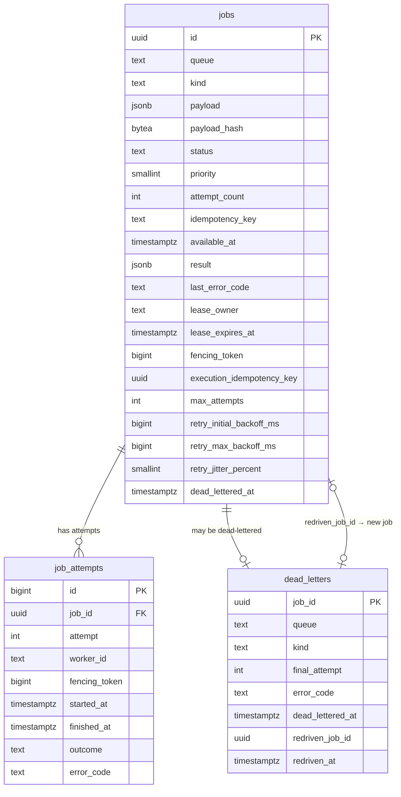

# TaskForge data model (schema v3)

PostgreSQL is the only durable store. The schema is defined by the embedded
migrations in [`db/migrations`](../db/migrations) and applied by
`taskforge-migrate` using goose. This document describes the schema after
migration `000003`.

## Entity relationships

## `jobs`

| Column | Type | Constraints / default | Purpose |
| --- | --- | --- | --- |
| `id` | `UUID` | PK | Generated by the application. |
| `queue` | `TEXT` | — | Validated as `^[a-z0-9][a-z0-9._-]{0,63}$`; default `default`. |
| `kind` | `TEXT` | — | Handler identifier, same pattern as queue. |
| `payload` | `JSONB` | must be an object | Canonicalized request payload. Sensitive. |
| `payload_hash` | `BYTEA` | exactly 32 bytes | SHA-256 submission fingerprint over queue, kind, payload, priority. |
| `status` | `TEXT` | `queued·running·succeeded·failed·canceled` | Current state. |
| `priority` | `SMALLINT` | `-100..100`, default 0 | Higher is claimed first. |
| `attempt_count` | `INTEGER` | `>= 0` | Incremented on each claim. |
| `idempotency_key` | `TEXT` | NULL or 1–128 chars | Client submission key, unique per queue. Sensitive. |
| `available_at` | `TIMESTAMPTZ` | default `NOW()` | Earliest claim time; pushed forward by retry backoff. |
| `result` | `JSONB` | nullable | Bounded handler result. Sensitive. |
| `last_error_code` | `TEXT` | `^[A-Z][A-Z0-9_]{0,63}$` | Most recent failure code. |
| `created_at`, `updated_at` | `TIMESTAMPTZ` | default `NOW()` | Audit timestamps. |
| `started_at` | `TIMESTAMPTZ` | nullable | Start of the most recent attempt. |
| `completed_at` | `TIMESTAMPTZ` | nullable | Set on terminal states. |
| `lease_owner` | `TEXT` | see lease check | Worker ID holding the lease. |
| `lease_expires_at` | `TIMESTAMPTZ` | see lease check | PostgreSQL-clock lease deadline. |
| `fencing_token` | `BIGINT` | `>= 0`, monotonic trigger | Incremented on each claim. |
| `execution_idempotency_key` | `UUID` | default `gen_random_uuid()` | Stable key passed to handlers; copied on redrive. Sensitive. |
| `max_attempts` | `INTEGER` | `1..100`, default 3 | Snapshotted retry policy (includes the first run). |
| `retry_initial_backoff_ms` | `BIGINT` | `1..86400000`, default 1000 | Snapshotted. |
| `retry_max_backoff_ms` | `BIGINT` | `>= initial`, `<= 86400000`, default 60000 | Snapshotted. |
| `retry_jitter_percent` | `SMALLINT` | `0..100`, default 20 | Snapshotted. |
| `dead_lettered_at` | `TIMESTAMPTZ` | nullable | Set when the job enters the DLQ. |

### Invariants

- **Lease check (`jobs_lease_state_check`)**: `running` ⇔ `lease_owner` and
  `lease_expires_at` are both non-NULL. Every non-running row has no lease.
- **Monotonic fencing (`jobs_fencing_token_monotonic` trigger)**: an update
  that lowers `fencing_token` raises an exception.
- **Submission uniqueness (`jobs_idempotency_key_unique`)**: partial unique
  index on `(queue, idempotency_key) WHERE idempotency_key IS NOT NULL`.

## `job_attempts`

One row per claim. Rows are closed (never deleted) by success, failure, or
recovery.

| Column | Type | Constraints | Purpose |
| --- | --- | --- | --- |
| `id` | `BIGINT` identity | PK | Surrogate key. |
| `job_id` | `UUID` | FK → `jobs.id` `ON DELETE CASCADE` | Owning job. |
| `attempt` | `INTEGER` | `>= 1`, unique with `job_id` | Attempt number at claim time. |
| `worker_id` | `TEXT` | NOT NULL | Claiming worker. |
| `fencing_token` | `BIGINT` | `> 0` | Token of this ownership epoch. |
| `started_at` | `TIMESTAMPTZ` | NOT NULL | Claim time. |
| `finished_at` | `TIMESTAMPTZ` | nullable | NULL while the attempt is open. |
| `outcome` | `TEXT` | `succeeded·failed·abandoned` | Final attempt result. |
| `error_code` | `TEXT` | code pattern | Failure code, e.g. `LEASE_EXPIRED`. |

A job in `running` state always has exactly one open attempt
(`finished_at IS NULL`) whose `fencing_token` equals the job's token.

## `dead_letters`

| Column | Type | Constraints | Purpose |
| --- | --- | --- | --- |
| `job_id` | `UUID` | PK, FK → `jobs.id` | The terminally failed original job. |
| `queue`, `kind` | `TEXT` | NOT NULL | Copied for filtering without joining. |
| `final_attempt` | `INTEGER` | `>= 1` | Attempt number that failed last. |
| `error_code` | `TEXT` | code pattern | Final failure code. |
| `dead_lettered_at` | `TIMESTAMPTZ` | default `NOW()` | DLQ entry time. |
| `redriven_job_id` | `UUID` | UNIQUE, FK → `jobs.id` | New job created by redrive. |
| `redriven_at` | `TIMESTAMPTZ` | NULL iff `redriven_job_id` NULL | Redrive time. |

No payloads, results, or keys are stored here by design (ADR 0009).

## Indexes and the queries they serve

| Index | Definition | Used by |
| --- | --- | --- |
| `jobs_idempotency_key_unique` | `UNIQUE (queue, idempotency_key) WHERE idempotency_key IS NOT NULL` | `CreateJob` conflict detection and replay lookup. |
| `jobs_claim_index` | `(priority DESC, created_at, id) WHERE status='queued'` | v0.1/v0.2 claim ordering. |
| `jobs_retry_eligibility_index` | `(available_at, priority DESC, created_at, id) WHERE status='queued'` | `ClaimNextJob` with `available_at <= NOW()`. |
| `jobs_expired_lease_index` | `(lease_expires_at, id) WHERE status='running'` | `RecoverExpiredJobs`. |
| `job_attempts_job_history_index` | `(job_id, attempt)` | Attempt history lookups. |
| `job_attempts_fencing_lookup_index` | `(job_id, fencing_token)` | Fenced attempt finalization. |
| `dead_letters_inspection_index` | `(dead_lettered_at DESC, job_id DESC)` | Keyset pagination in `ListDeadLetters`. |

## Migration history

| Version | File | Release | Summary |
| --- | --- | --- | --- |
| 1 | `000001_create_jobs.sql` | v0.1 | `jobs`, `job_attempts`, idempotency and claim indexes. |
| 2 | `000002_add_job_leases.sql` | v0.2 | Lease and fencing columns, monotonic trigger, `abandoned` outcome, lease invariant. Recovers v0.1 `running` rows as `abandoned` (`V01_MIGRATION_RECOVERY`) and requeues them. |
| 3 | `000003_add_retry_and_dead_letters.sql` | v0.3 | Execution key, retry snapshot columns, `dead_lettered_at`, `dead_letters` table, retry eligibility and DLQ indexes. |

### Migration rules

- Migrations are append-only; never edit a released file.
- Every migration has a `-- +goose Down` section. Down migrations may be lossy
  (for example, `000002` down rewrites `abandoned` attempts to `failed`).
- Upgrades that tighten invariants must first repair existing rows in the same
  migration (see `000002`).
- Upgrade paths are integration-tested (`TestV01RunningJobUpgradeIntegration`,
  `TestV02SchemaUpgradeIntegration`).
- Add a migration file and update this document and `CURRENT_STATE.md` in the
  same change.
