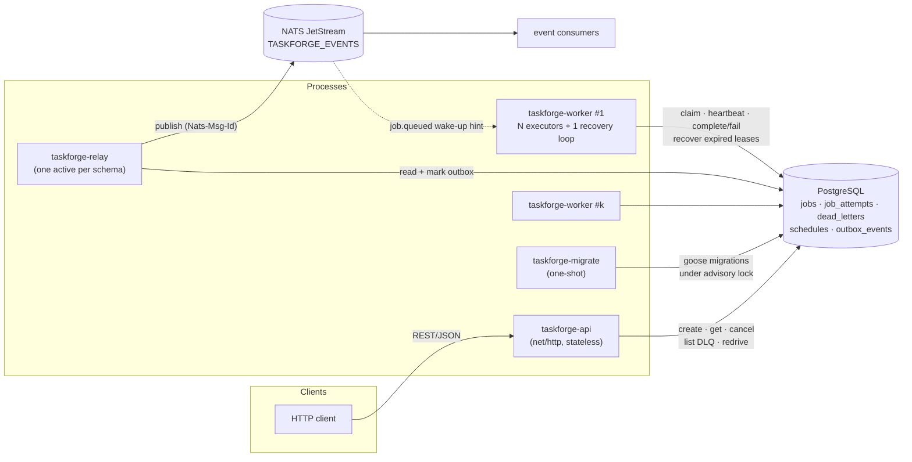
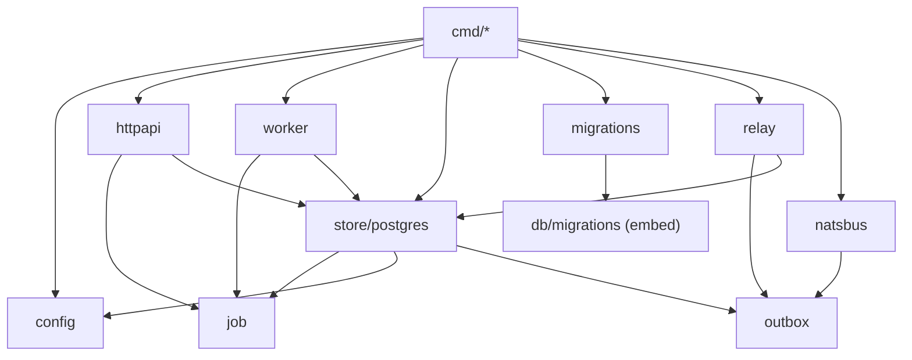
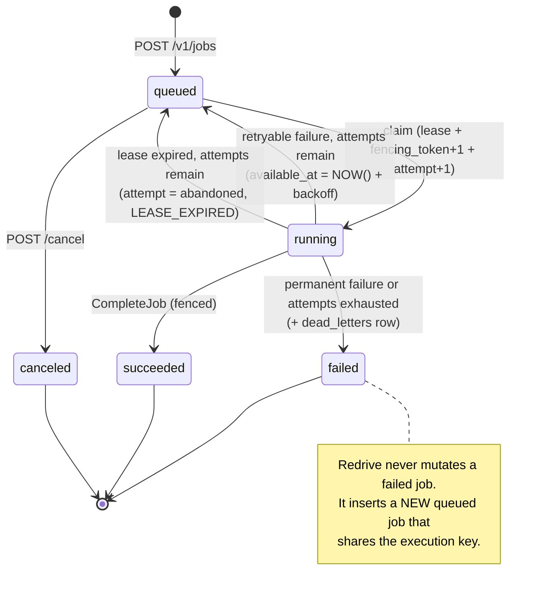
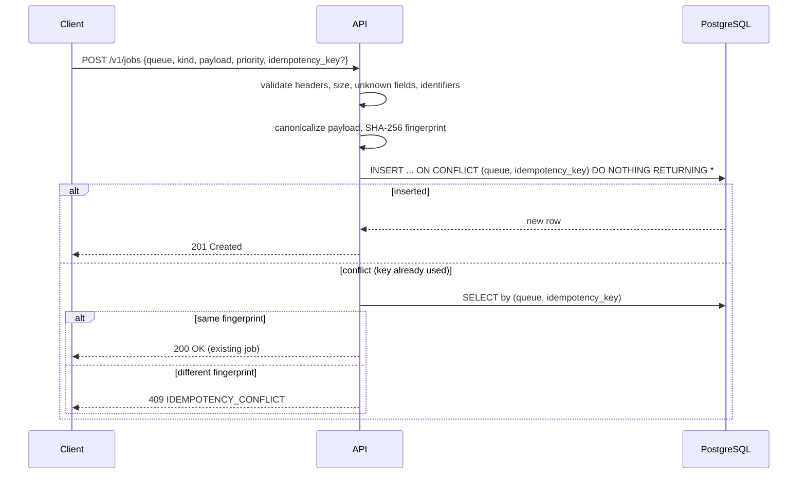
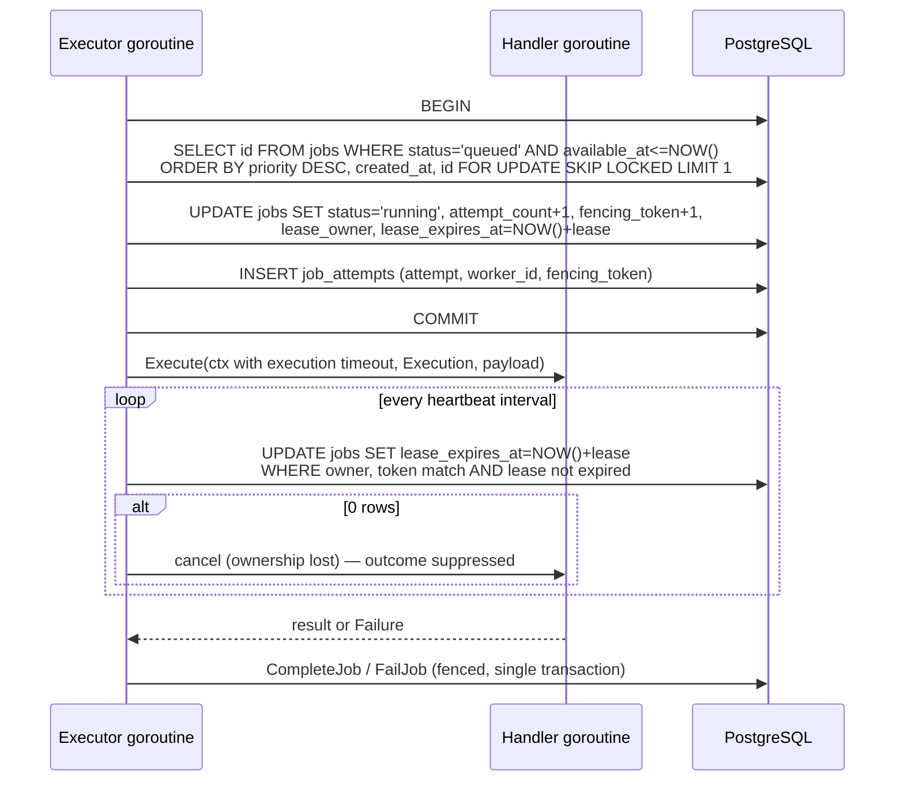
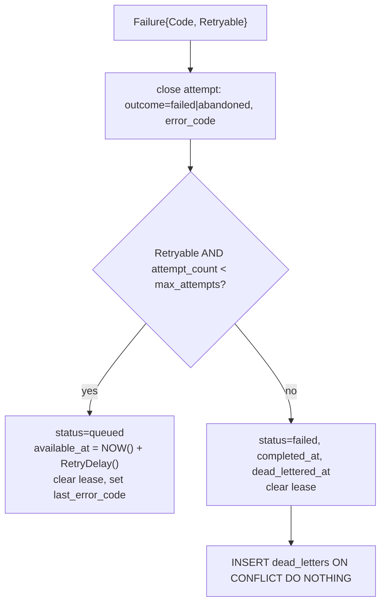
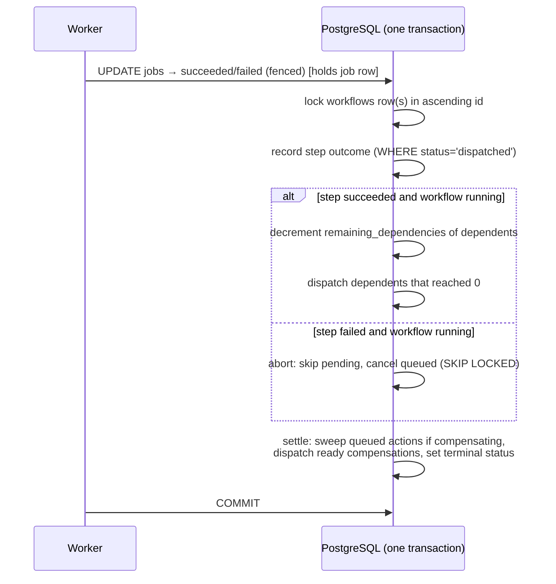
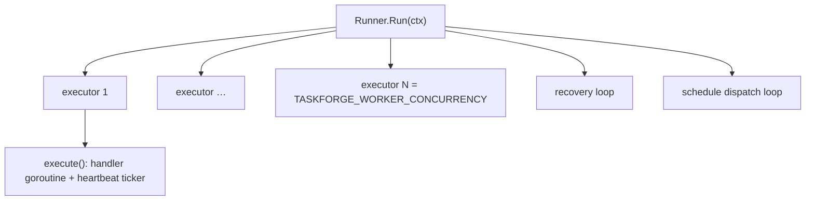

# TaskForge system design (v0.7)

This document describes how TaskForge is built: its components, package
structure, concurrency model, the transactional protocols behind every job
state change, and the failure modes those protocols are designed to survive.
For *why* individual decisions were made, see the [ADRs](adr/README.md). For
the database schema see [DATA_MODEL.md](DATA_MODEL.md), and for the HTTP
contract see [API.md](API.md).

## 1. Goals and non-goals

Goals:

- Durable job submission and state that survive process restarts and crashes.
- Client-controlled delayed jobs (`run_at` / `delay_seconds`) and durable
  recurring cron schedules with IANA timezone evaluation.
- Safe cooperation of many worker processes without a coordinator other than
  PostgreSQL.
- Explicit, documented delivery semantics: **at least once**.
- Bounded everything: connections, goroutines, batch sizes, payloads, results,
  timeouts, retries, and page sizes.
- No leakage of payloads, results, idempotency keys, or credentials through the
  public API or logs.
- Workflow DAGs with saga compensation whose state is exactly as consistent as
  job state.

- Operable with measurable targets: one trace per job across processes,
  bounded metrics, and SLOs with tested alerts (v0.7).

Non-goals for v0.7: exactly-once execution or delivery, dispatching jobs
through the broker, data flow or conditional branches between workflow steps,
trace propagation through NATS, authentication, multi-tenancy, and execution
of arbitrary user code.

## 2. Component view



| Process | Responsibility | Scaling | State |
| --- | --- | --- | --- |
| `taskforge-api` | Validates and persists submissions; read/cancel; DLQ inspection and redrive; health/readiness. | Horizontally, any number of replicas. | Stateless. |
| `taskforge-worker` | Claims and executes jobs through a fixed executor pool; renews leases; persists outcomes; recovers expired leases. | Horizontally; each process has a unique `TASKFORGE_WORKER_ID`. | Only in-flight executions. |
| `taskforge-relay` | Publishes committed outbox events to NATS JetStream in order; purges old published rows. | Run one or more; an advisory lock keeps exactly one active. | None (progress is in `outbox_events`). |
| NATS JetStream | Stores and fans out lifecycle events; carries worker wake-up hints. | Single server in Compose (clustering is v0.8). | Event stream only; never job state. |
| `taskforge-migrate` | Applies embedded SQL migrations, then exits. | Run once per deploy; concurrent runs serialize on a session lock. | None. |
| PostgreSQL | Single durable source of truth and coordination point. | Single primary (HA is v0.8). | All durable state. |

The API and worker **never** run migrations. Deploy order is always
PostgreSQL → `taskforge-migrate` (to completion) → API and workers. Compose
encodes this with `service_healthy` and `service_completed_successfully`.

## 3. Package structure

```text
cmd/
  taskforge-api/       wiring: config → store → httpapi → http.Server; signal-driven shutdown
  taskforge-worker/    wiring: config → store → registry → worker.Runner
  taskforge-migrate/   wiring: config → migrations.Run
  taskforge-relay/     wiring: config → store → natsbus.Publisher → relay.Runner
internal/
  config/              env parsing, defaults, bounds, cross-field validation
  job/                 pure domain: Job, Submission, Execution, Failure, DeadLetter,
                       status set, canonical fingerprint, RetryDelay
  httpapi/             HTTP routing, request validation, response shaping, error envelope
  store/postgres/      explicit SQL; transactions; error classification
  worker/              executor pool, heartbeat, shutdown drain, handler registry
  migrations/          goose provider with PostgreSQL session locker
  outbox/              event contract: subjects, message IDs, versioned body (no broker dependency)
  natsbus/             NATS adapter: JetStream stream/publisher, wake-up subscription
  relay/               outbox → JetStream loop: batching, stream setup, purge
db/migrations/         versioned SQL files embedded into the binaries
```

Dependency direction (no cycles; `job` depends on nothing internal):



`httpapi` and `worker` each declare a narrow `Store` interface containing only
the methods they need. `*postgres.Store` satisfies both, and unit tests use
in-memory fakes. Concurrency-sensitive SQL is never mocked; it is covered by
integration tests against real PostgreSQL (see [TESTING.md](TESTING.md)).

## 4. Domain model

| Type | Meaning |
| --- | --- |
| `job.Job` | Full durable row, including lease, fencing, and retry snapshot fields. |
| `job.Submission` | Validated, canonicalized creation request plus its SHA-256 fingerprint. |
| `job.Execution` | One ownership epoch: `(JobID, Attempt, WorkerID, FencingToken, ExecutionKey)`. Every worker mutation must present it. |
| `job.Failure` | `{Code, Retryable}`; `Code` must match `^[A-Z][A-Z0-9_]{0,63}$`. |
| `job.DeadLetter` | Payload-free operational record of a terminally failed job. |

### Job state machine



Transitions are enforced by the `WHERE` clauses of the SQL statements
(`status = 'queued'`, `status = 'running' AND lease_owner = … AND
fencing_token = …`), not by application-side checks. `job.ValidateTransition`
documents the user-visible subset and is unit-tested, but the database is the
enforcement point.

## 5. Core protocols

All timestamps that affect correctness (`lease_expires_at`, `available_at`,
`started_at`, `completed_at`) come from PostgreSQL `NOW()`, so worker clock
skew cannot shorten or extend leases or backoff.

### 5.1 Submission



The retry policy (`max_attempts`, backoff bounds, jitter) and a random
`execution_idempotency_key` are written at creation time. The policy comes from
the **API process's** configuration; changing worker retry settings does not
affect already-created jobs.

### 5.2 Claim, execute, heartbeat, finish



Key properties:

- Claim, state change, and attempt insert are one transaction; there is never a
  `running` job without its open attempt.
- `SKIP LOCKED` lets concurrent claimers pass over each other's rows. It
  maximizes throughput and does not guarantee strict FIFO fairness.
- The fencing token is incremented on every claim and is guarded by a trigger
  that rejects any decrease.
- Success requires `lease_expires_at > NOW()`; a worker whose lease already
  expired cannot record success even if recovery has not run yet.

### 5.3 Failure, retry, and dead-lettering

`FailJob` locks the row `FOR UPDATE` with the full fenced identity, then calls
`finalizeFailure` inside the same transaction:



`RetryDelay(jobID, failedAttempt, initial, max, jitter%)`:

1. `delay = initial · 2^(failedAttempt−1)`, doubled step by step and capped at
   `max` before it can overflow.
2. If jitter > 0, `span = delay · jitter / 100` and
   `offset ∈ [−span, +span]` is derived from `SHA-256(jobID ":" attempt)`.
3. Result is clamped to `[0, max]`.

Jitter is deterministic so that tests can assert exact values while different
jobs still spread out. With defaults (1 s initial, 60 s max, 20 % jitter,
3 attempts) a job that always fails runs at roughly t=0, t≈1 s, t≈3 s and is
then dead-lettered.

### 5.4 Expired-lease recovery

Each worker process runs one recovery loop every `TASKFORGE_RECOVERY_INTERVAL`:

1. `BEGIN`; select up to `RECOVERY_BATCH_SIZE` rows with
   `status='running' AND lease_expires_at <= NOW()` using
   `FOR UPDATE SKIP LOCKED`.
2. For each row call `finalizeFailure` with
   `Failure{LEASE_EXPIRED, Retryable: true}` and attempt outcome `abandoned`.
3. `COMMIT`.

Because recovery reuses the retry path, an abandoned attempt consumes one of
`max_attempts`, waits for backoff, and dead-letters with `LEASE_EXPIRED` once
attempts are exhausted. `SKIP LOCKED` ensures concurrent recovery loops never
recover the same ownership epoch twice.

### 5.5 Redrive

```mermaid
sequenceDiagram
    participant C as Operator
    participant A as API
    participant D as PostgreSQL
    C->>A: POST /v1/dead-letters/{job-id}/redrive
    A->>D: BEGIN; SELECT redriven_job_id FROM dead_letters WHERE job_id=$1 FOR UPDATE
    alt already redriven
        A->>D: SELECT the linked job; COMMIT
        A-->>C: 200 OK (same new job)
    else first redrive
        A->>D: INSERT new job copying queue, kind, payload, priority,<br/>execution key and retry snapshot; idempotency_key = NULL
        A->>D: UPDATE dead_letters SET redriven_job_id, redriven_at
        A->>D: COMMIT
        A-->>C: 201 Created (new job)
    end
```

The original job and its attempt history are never modified. The row lock on
the dead letter serializes concurrent redrives so exactly one new job exists.

### 5.6 Recurring schedule dispatch

Each worker process runs one bounded schedule dispatcher loop every
`TASKFORGE_SCHEDULE_INTERVAL`:

1. `BEGIN`; select up to `TASKFORGE_SCHEDULE_BATCH_SIZE` unpaused rows with
   `next_run_at <= NOW()` using `FOR UPDATE SKIP LOCKED`.
2. For each due schedule, enqueue at most one `queued` job for
   `(schedule_id, scheduled_for = next_run_at)` using
   `ON CONFLICT (schedule_id, scheduled_for) WHERE schedule_id IS NOT NULL DO NOTHING`.
3. Advance `next_run_at` to the next cron tick strictly after
   `GREATEST(next_run_at, NOW())` in the schedule's IANA timezone, and record
   `last_run_at` and `last_job_id`.
4. `COMMIT`.

Missed ticks while workers were down or while a schedule was paused coalesce
into at most one catch-up job, preventing backlog floods.

### 5.7 Transactional outbox and relay

Full contract: [EVENTS.md](EVENTS.md); rationale: [ADR 0011](adr/0011-transactional-outbox-and-nats-jetstream.md).

1. Triggers on `jobs` (`AFTER INSERT`, and `AFTER UPDATE OF status` when the
   status changes) insert one `outbox_events` row in the same transaction as
   the change. Every code path that creates or transitions a job is covered.
2. The relay opens a transaction bounded by `TASKFORGE_OUTBOX_BATCH_TIMEOUT`
   and takes `pg_try_advisory_xact_lock(class, hashtext(current_schema()))`.
   If another relay holds it, this one stands by (`ErrOutboxBusy`).
3. It reads up to `TASKFORGE_OUTBOX_BATCH_SIZE` unpublished rows in id order
   and publishes each synchronously with `Nats-Msg-Id: taskforge-outbox-<id>`,
   stopping at the first failure.
4. Only the acknowledged prefix is marked `published_at = NOW()`; the
   transaction commits. Marking uses a fresh query timeout so a slow broker
   that exhausted the batch budget cannot discard acknowledged progress. A full batch re-runs immediately; otherwise the relay
   waits `TASKFORGE_OUTBOX_POLL_INTERVAL`.
5. After a publish failure the relay re-ensures the stream before retrying.
   Once a minute it deletes published rows older than
   `TASKFORGE_OUTBOX_RETENTION` (bounded) and logs the backlog.

Per-job order holds because a job's transitions are serialized by its row
lock (a later event always has a larger id and commits later), one relay
publishes at a time, and only an in-order prefix is ever marked.

### 5.8 Worker wake-ups

With `TASKFORGE_NATS_URL` set, each worker subscribes (core NATS) to
`taskforge.events.job.queued`. If the event shows the job was due when it
occurred (`available_at <= occurred_at`, both PostgreSQL timestamps), the
handler does a non-blocking send on a buffered channel. Executors select on
the poll timer **or** that channel, then call `ClaimNextJob` as usual. Lost,
late, or duplicate hints only change latency, never correctness.

### 5.9 Workflow engine

Full concepts are in [WORKFLOWS.md](WORKFLOWS.md) and the decision in
[ADR 0012](adr/0012-workflow-dags-and-saga-compensation.md). The engine lives
in `internal/store/postgres/workflow_engine.go`; the pure decisions it relies
on (`ReadyCompensations`, `Settle`) live in `internal/job/workflow_decide.go`.



Entry points are `finishJob` (completion) and the terminal branch of
`finalizeFailure` (used by `FailJob` and lease recovery). `CancelWorkflow`
locks the workflow's queued jobs, then the workflow row, then aborts.
`CancelQueuedJob` rejects workflow-owned jobs, and redrive inserts a
standalone job, so no other path can make a workflow job terminal.

Key mechanics:

- **Lock order:** job rows → `workflows` rows ascending → `workflow_steps`.
  A transaction that touches several workflows (a recovery batch) locks all of
  them first. Waiting on a job row while holding a workflow row is avoided by
  using `SKIP LOCKED` for engine-side cancellation.
- **Recovery isolation:** each expired job is recovered under its own
  savepoint, so a job whose workflow cannot advance is reported and skipped
  instead of blocking recovery for every queue.
- **Exactly-once dispatch:** fan-in counter under the workflow row lock, step
  status guards, and the unique `(workflow_step_id, workflow_role)` index.
- **Timestamps:** dispatched jobs use `clock_timestamp()` for `created_at`;
  `NOW()` would be the start of a transaction that may have waited on the
  workflow lock while a dependency completed.
- **Consistent reads:** `GetWorkflow` reads the workflow and its steps in one
  read-only REPEATABLE READ transaction.

### 5.10 Observability

Full catalog in [OBSERVABILITY.md](OBSERVABILITY.md); decision in
[ADR 0013](adr/0013-trace-context-through-the-database.md); targets in
[SLO.md](SLO.md).

- **Trace context in the row.** Every job-creating statement stores
  `tracectx.FromContext(ctx)` as `trace_parent`; `trace_link` is computed in
  SQL (`available_at > NOW()` at insertion). `internal/tracectx` and the store
  use only the OpenTelemetry API; exporters and sampling live in
  `internal/telemetry`.
- **Attempt spans.** `telemetry.StartAttempt` makes the attempt a child of the
  stored context, a linked root for delayed jobs, or a new root. The worker
  attaches the span to its handler and persistence contexts explicitly, so the
  workflow engine stamps it on every job it dispatches in that transaction.
- **After-commit observer.** The store buffers outcomes per transaction and
  per recovery savepoint and reports them to `telemetry.Metrics` only after
  commit.
- **Isolation.** Batch export with a bounded queue, timeout, and no retries;
  failures are counted and logged once a minute. Metrics listeners are separate
  from the API listener and fail startup if they cannot bind.

## 6. Worker concurrency model



- Exactly `Concurrency + 2` long-lived goroutines per process, plus at most one
  handler goroutine per executor. There is no unbounded fan-out.
- An executor that finds no eligible job sleeps `TASKFORGE_WORKER_POLL_INTERVAL`;
  after finishing a job it polls again immediately.
- The handler runs under a context derived from `context.Background()` with
  `TASKFORGE_JOB_EXECUTION_TIMEOUT`, so shutdown signals do not abort it
  instantly; the drain logic below decides when to cancel.
- Heartbeat RPCs are bounded by the heartbeat interval; outcome persistence is
  bounded by `TASKFORGE_SHUTDOWN_TIMEOUT`.

### Graceful shutdown

1. SIGINT/SIGTERM cancels the run context. Executors stop claiming and the
   recovery loop exits.
2. Each in-flight execution starts a drain timer (`TASKFORGE_SHUTDOWN_TIMEOUT`)
   and keeps heartbeating.
3. If the handler finishes in time, its outcome is persisted normally.
4. If the drain timer fires, the handler is cancelled and a retryable
   `SHUTDOWN_TIMEOUT` failure is persisted (bounded by
   `TASKFORGE_SHUTDOWN_TIMEOUT`), so the job follows the normal retry policy
   without waiting for lease expiry. If that write fails, the job stays
   `running` until its lease expires and recovery requeues it with
   `LEASE_EXPIRED`. A handler that ignores cancellation may still be running
   locally; fencing keeps its late outcome from mutating the job.

## 7. Handler contract

```go
type Handler interface {
    Execute(ctx context.Context, exec job.Execution, payload json.RawMessage) (json.RawMessage, *job.Failure)
}
```

- Return `(result, nil)` for success. The result must be valid JSON within
  `TASKFORGE_JOB_RESULT_MAX_BYTES`; otherwise the store rejects it and the
  runner fails the job permanently with `INVALID_JOB_RESULT`.
- Return `(nil, &job.Failure{Code, Retryable})` for failure. Codes must be
  stable, uppercase machine codes and must not contain sensitive data.
- Respect `ctx` cancellation; it fires on execution timeout, lost ownership,
  or expired shutdown drain.
- Use `exec.ExecutionKey` (stable across retries, recovery, and redrive) as the
  idempotency key for external side effects, or pass `exec.FencingToken` to a
  downstream that enforces monotonic tokens.

For workflow jobs `exec.Workflow` is set. A compensation receives
`CompensatesExecutionKey`, the execution key of the action it undoes, and
should use it to reverse exactly that downstream effect (see
[WORKFLOWS.md](WORKFLOWS.md#writing-an-idempotent-compensation)).

The registry is a fixed, compile-time map with four safe demo handlers:
`demo.echo` (expects `{"message": "<non-empty string>"}` and echoes it),
`demo.fail` (always fails permanently), `demo.flaky` (fails retryably for the
first N attempts), and `demo.sleep` (sleeps, honoring cancellation). Unknown
kinds fail permanently with `UNKNOWN_JOB_KIND`.

## 8. Failure-mode analysis

| Scenario | What happens | Guarantee |
| --- | --- | --- |
| API crashes after `INSERT` commits but before responding | Client retries with the same idempotency key and gets `200` with the same job. | No duplicate job (when a key is used). |
| Two clients submit the same key concurrently | Unique index + `ON CONFLICT DO NOTHING`; loser reads the winner's row. | One job. |
| Two executors claim simultaneously | `SKIP LOCKED` gives each a different row. | One owner per job. |
| Worker hard-crashes mid-handler | Lease expires; recovery marks attempt `abandoned`, requeues with backoff. | Job eventually re-runs or dead-letters. |
| Worker is paused (GC, VM freeze) past its lease, then resumes | Its heartbeat or outcome write finds a different token/expired lease → `ErrOwnershipLost`; outcome suppressed. | Stale writer cannot change TaskForge state. |
| Crash after an external side effect but before `CompleteJob` | Handler runs again on a later attempt. | **At least once.** External systems must dedupe by execution key. |
| PostgreSQL unavailable | Store returns `ErrUnavailable`; API → `503`, worker logs and polls again; `/readyz` fails. | No partial transitions (transactions roll back). |
| Concurrent redrive requests | Dead-letter row lock serializes them. | One new job. |
| Concurrent migration commands | Goose session lock serializes them; the second sees an up-to-date schema. | Migrations applied once. |
| Shutdown drain expires | Handler cancelled; retryable `SHUTDOWN_TIMEOUT` persisted, falling back to lease-expiry recovery if the write fails. | Bounded by drain + outcome write; at least once. |
| Relay crashes after publishing, before commit | Rows stay unpublished and are republished; JetStream drops duplicates within the window. | At-least-once events; consumers dedupe by `event_id`. |
| NATS unavailable | Relay publishes nothing and retries; backlog accumulates in `outbox_events`; workers fall back to polling. | No job processing impact; events delayed, not lost. |
| Two relays running | Advisory lock lets one publish; the other stands by and takes over automatically. | Per-job order preserved. |
| Handler returns invalid or oversized JSON | `CompleteJob` returns `ErrInvalidResult`; runner fails the job with permanent `INVALID_JOB_RESULT`. | Dead-lettered immediately instead of after lease expiry. |
| Parallel workflow steps finish at the same instant | Workflow row lock serializes the fan-in counter; unique index backstops dispatch. | Dependent dispatched exactly once. |
| Two recovery batches hold jobs of the same workflows in opposite order | Workflow rows locked in ascending id order before any job is recovered. | No deadlock (proven by a test that fails with `40P01` without the ordering). |
| A workflow step job cannot be advanced (bug or manual edit) | Its recovery savepoint rolls back; the error is reported; other jobs commit. | Lease recovery never stalls globally. |
| Worker crashes mid-compensation | Lease expiry requeues the compensation; it reruns with the same `CompensatesExecutionKey`; the dead worker is fenced out. | Saga completes; compensation at least once. |
| Workflow canceled while a step is running | Pending steps skipped, queued ones canceled; the running step finishes and is compensated if it succeeded. | Workflow ends `canceled` with every succeeded step compensated. |

## 9. Security and privacy design

- The API never returns `payload`, `result`, `idempotency_key`, or
  `execution_idempotency_key`; it reports only `has_result` and `result_bytes`.
- Dead letters copy no payloads, results, or keys.
- Error codes are validated against a strict pattern before storage, which
  prevents raw error strings (possibly containing data) from being persisted.
- Raw PostgreSQL errors are mapped to a small set of public codes.
- Logs are structured JSON with fixed event names and no request bodies, DSNs,
  or keys.
- Request bodies are size-limited, must be `application/json` (UTF-8 only),
  reject `Content-Encoding`, unknown fields, and trailing data.
- Containers run as `nonroot` on a distroless static image.
- There is still **no authentication or TLS**; see [SECURITY.md](../SECURITY.md).

## 10. Known design gaps (tracked for later versions)

- Retry policy is global per API process; there is no per-queue or per-kind
  policy and no client-provided policy.
- No retention or archival for `jobs`, `job_attempts`, or `dead_letters`.
- Relay publishing is synchronous (one broker round trip per event); async
  batching would raise throughput at the cost of a more complex ordering rule.
- Events are not published for schedule changes or workflow-level
  transitions, only for job transitions.
- Workflows have no data flow between steps, no conditional branches, and no
  way to resume after a redrive; succeeded workflows report
  `compensation_status = waiting` for steps whose compensation was never
  needed.
- The relay polls the outbox; `LISTEN/NOTIFY` could lower event latency.
- `/healthz` container healthcheck targets the fixed address `127.0.0.1:8080`.
