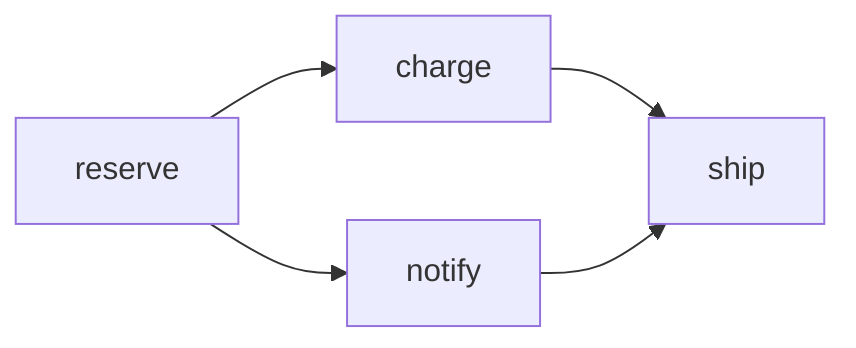
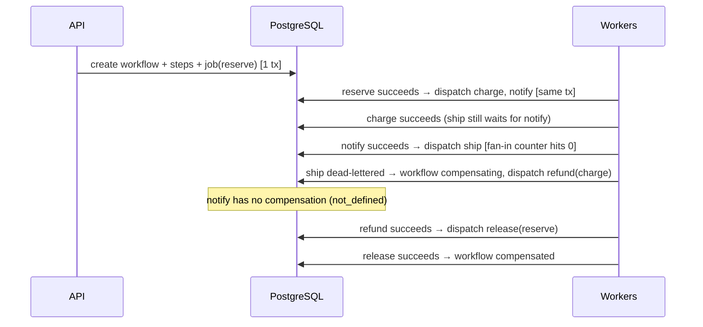
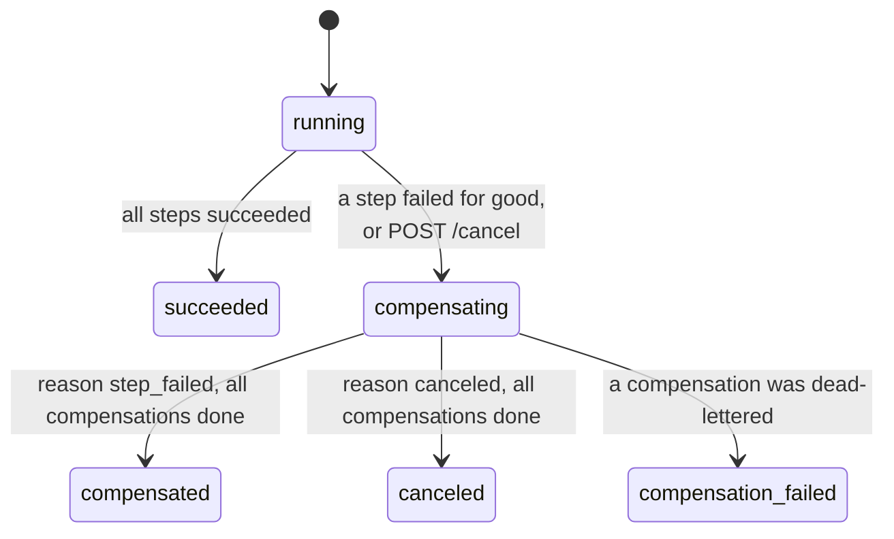

# Workflows and saga compensation (v0.6)

A **workflow** is a set of ordinary jobs, called **steps**, with dependencies
between them. Steps run as soon as all their dependencies have succeeded, in
parallel where the graph allows. A step may declare a **compensation**: a job
that undoes its effect. If any step fails for good, or the workflow is
canceled, TaskForge stops starting new steps and runs the compensations of the
steps that already succeeded, newest dependencies first. This is the saga
pattern.

Design rationale: [ADR 0012](adr/0012-workflow-dags-and-saga-compensation.md).
HTTP contract: [API.md](API.md#workflows).

## A worked example

```json
{
  "label": "order-1042",
  "idempotency_key": "order-1042-v1",
  "steps": [
    {"name": "reserve", "kind": "demo.echo", "payload": {"message": "reserve"},
     "compensation": {"kind": "demo.echo", "payload": {"message": "release"}}},
    {"name": "charge", "kind": "demo.echo", "payload": {"message": "charge"},
     "depends_on": ["reserve"],
     "compensation": {"kind": "demo.echo", "payload": {"message": "refund"}}},
    {"name": "notify", "kind": "demo.echo", "payload": {"message": "email"},
     "depends_on": ["reserve"]},
    {"name": "ship", "kind": "demo.fail", "payload": {},
     "depends_on": ["charge", "notify"]}
  ]
}
```





## State machines



| Step status | Meaning |
| --- | --- |
| `pending` | Waiting for dependencies; no job yet. |
| `dispatched` | Its job exists (queued, retrying, or running). |
| `succeeded` / `failed` | Its job succeeded / was dead-lettered. |
| `canceled` | Its job was still queued when the workflow aborted. |
| `skipped` | Never started because the workflow aborted. |

| Compensation status | Meaning |
| --- | --- |
| `none` | Not applicable: the step did not succeed. |
| `waiting` | The step succeeded and has a compensation that has not run. In a `succeeded` workflow this simply means "available, never needed". |
| `dispatched` / `succeeded` / `failed` | The compensation job is live / done / dead-lettered. |
| `not_defined` | The step succeeded and declared no compensation. |

## Rules when a workflow aborts

- Pending steps are skipped.
- Queued actions are canceled, including ones waiting in retry backoff.
- Running actions are left to finish. If one succeeds, it is compensated like
  any other succeeded step; if it fails, it is not. A retryable failure after
  the abort is final: the step is not retried, because a stopped workflow
  starts no new actions. Compensations still retry normally.
- A failed step is never compensated: a failed action is assumed to have left
  no committed effect.
- Compensations run in reverse dependency order. A step's compensation starts
  only after every succeeded step that depends on it has been compensated and
  no step that depends on it is still running. Independent branches compensate
  in parallel.
- If a compensation is dead-lettered, the workflow becomes
  `compensation_failed` immediately and no further compensations start. An
  operator decides what to do (see [OPERATIONS.md](OPERATIONS.md)).

## Guarantees

- A workflow advances in the same transaction as the job outcome that caused
  it, so the two never disagree (ADR 0012).
- Each step gets exactly one action job, created only after all its
  dependencies succeeded, even when they finish at the same moment on
  different workers.
- Each succeeded step gets at most one compensation job.
- Workers, recovery, and cancel cannot deadlock each other on workflow rows.
- Every terminal workflow eventually has no live jobs.

## Non-guarantees

- **At least once.** Steps and compensations can run more than once (crash,
  lease expiry). Make them idempotent.
- No data flows between steps; payloads are fixed at submission.
- No conditional branches, loops, or sub-workflows.
- Redriving a dead-lettered workflow job creates a standalone job; it does not
  resume the workflow.

## Writing an idempotent compensation

Every handler receives `job.Execution`. For workflow jobs it carries a
`Workflow *job.WorkflowContext`:

| Field | Action job | Compensation job |
| --- | --- | --- |
| `WorkflowID`, `Step`, `Role` | set | set |
| `CompensatesJobID` | empty | the action job being undone |
| `CompensatesExecutionKey` | empty | the action job's execution key |

Use the action's execution key end to end: the action sends it to the
downstream system as an idempotency key ("charge with key K"), and the
compensation asks the downstream to reverse exactly that operation ("refund
the charge made with key K"). If the compensation runs twice, the downstream
sees the same key twice and can ignore the duplicate. The key never appears in
API responses or logs.

**Also put a business reference in the compensation payload** (for example
`{"order_id": "1042"}`), and make the handler work when `exec.Workflow` is
`nil`. An operator who redrives a dead-lettered compensation gets a standalone
job: it keeps its payload but has no workflow context, so
`CompensatesExecutionKey` is not available. A handler that can undo the effect
from its payload alone (falling back from the key to the reference) stays
usable in that recovery path.

## Demo handlers

| Kind | Payload | Behavior |
| --- | --- | --- |
| `demo.echo` | `{"message": "…"}` | Succeeds and echoes the message. |
| `demo.fail` | `{"code"?: "UPPER_CODE"}` | Always fails permanently (`DEMO_FAILURE` by default). |
| `demo.flaky` | `{"fail_attempts": 0..10}` | Fails retryably (`DEMO_TRANSIENT`) until that many attempts have failed. |
| `demo.sleep` | `{"ms": 0..60000}` | Sleeps, honoring cancellation; keeps a step in flight. |

## Correctness evidence

The tests check these invariants directly in the database after scenario,
race, crash-injection, and randomized soak runs:

| # | Invariant |
| --- | --- |
| I1 | At most one action and one compensation job per step. |
| I2 | An action job is created only after every dependency succeeded. |
| I3 | A succeeded workflow has only succeeded steps and no compensation jobs. |
| I4 | A compensated or canceled workflow compensated every succeeded step. |
| I5 | A compensation is created only after its dependents finished and were compensated. |
| I6 | A terminal workflow has a completion time and, once quiescent, no live jobs. |
| I7 | `compensation_failed` implies a dead-lettered compensation. |
| I8 | Step state agrees with its jobs, checked from both sides. |
| I9 | A non-terminal workflow always has live work (nothing is stuck). |

See [TESTING.md](TESTING.md#workflow-correctness) for how they are exercised.
