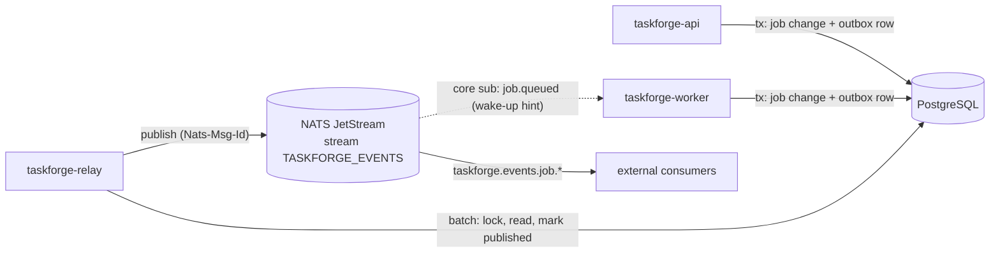

# TaskForge v0.5 design: transactional outbox and NATS JetStream

- Date: 2026-11-07
- Status: Draft for implementation
- Roadmap item: v0.5 "Transactional outbox and NATS JetStream"

## Intent

Through v0.4, TaskForge's job lifecycle is visible only by polling the HTTP
API, and workers find new work only by polling PostgreSQL. v0.5 adds two
capabilities without weakening PostgreSQL's role as the single source of
truth:

1. **Lifecycle events for outside consumers.** Every job state transition
   produces a durable, privacy-safe event that is published to a NATS
   JetStream stream. Downstream systems (notifications, analytics, audit, a
   future v0.6 workflow engine) subscribe instead of polling the API.
2. **Low-latency wake-ups for workers.** Workers optionally listen for
   "job queued" events and claim immediately instead of waiting for the next
   poll. Polling remains the correctness fallback.

The educational goal is to demonstrate the transactional outbox pattern
correctly: an event exists **if and only if** the state change committed, and
publication is at least once with broker-side deduplication.

The product owner skipped the design Q&A and asked to proceed from the
roadmap. Every decision below is therefore the builder's call, grounded in the
existing architecture and ADRs 0001–0010.

## Goals

- Atomicity: an outbox row is written in the same transaction as the job
  state change that caused it, for every code path (submit, claim, complete,
  fail/retry, recover, dead-letter, cancel, redrive, schedule dispatch).
- At-least-once publication to JetStream with `Nats-Msg-Id` deduplication.
- Per-job event ordering preserved end to end under normal operation.
- Events never contain payloads, results, idempotency keys, execution keys,
  lease owners, or credentials.
- NATS is optional for the API and workers; required only for the relay.
- Everything stays bounded: batch sizes, timeouts, retention, connections.
- Real-dependency tests: PostgreSQL and NATS JetStream, not mocks, for
  correctness-sensitive behavior.

## Non-goals

- Exactly-once delivery to consumers. Consumers deduplicate by `event_id`.
- Dispatching jobs through NATS. Claims still happen only via PostgreSQL
  `FOR UPDATE SKIP LOCKED`; a lost or duplicate wake-up cannot lose or
  duplicate a job.
- Events for schedules (create/pause/resume/delete). Only job lifecycle.
- A consumer SDK, an event replay HTTP API, or schema registry.
- NATS authentication/TLS configuration beyond what a `nats://` or `tls://`
  URL can carry. (Same development-only posture as the rest of TaskForge.)
- Backfilling events for jobs that existed before the migration.

## Anti-goals (would make v0.5 a failure even if it "works")

- Publishing directly to NATS from request handlers or workers (dual write).
- An event that can be observed for a transition that rolled back.
- Leaking job payloads or results onto the bus.
- Workers that stop processing when NATS is unavailable.
- An outbox table that grows without bound in steady state.

## Architecture



### 1. Outbox table and trigger (migration `000005_add_outbox.sql`)

```sql
CREATE TABLE outbox_events (
    id BIGINT GENERATED ALWAYS AS IDENTITY PRIMARY KEY,
    job_id UUID NOT NULL,              -- no FK: events outlive any future job retention
    event_type TEXT NOT NULL CHECK (event_type IN (
        'job.queued', 'job.started', 'job.retry_scheduled',
        'job.succeeded', 'job.failed', 'job.canceled')),
    payload JSONB NOT NULL,            -- privacy-safe job snapshot (below)
    created_at TIMESTAMPTZ NOT NULL DEFAULT NOW(),
    published_at TIMESTAMPTZ
);
CREATE INDEX outbox_events_unpublished_index ON outbox_events (id) WHERE published_at IS NULL;
CREATE INDEX outbox_events_published_index ON outbox_events (published_at) WHERE published_at IS NOT NULL;
```

Events are written by PostgreSQL triggers on `jobs`, not by Go code at each
call site. Decision rationale: job rows are created or transitioned from
eight different store methods (`CreateJob`, `ClaimNextJob`, `finishJob`,
`finalizeFailure` via `FailJob` and `RecoverExpiredJobs`, `CancelQueuedJob`,
`RedriveDeadLetter`, `DispatchDueSchedules`). A trigger runs inside whichever
transaction changes the row, so atomicity holds by construction and a future
code path cannot forget to emit. The project already uses a trigger for
fencing-token monotonicity (migration 2), so this is an established pattern.

- `AFTER INSERT ON jobs` → `job.queued`.
- `AFTER UPDATE OF status ON jobs ... WHEN (OLD.status IS DISTINCT FROM NEW.status)`:

| Transition | Event |
| --- | --- |
| `queued → running` | `job.started` |
| `running → queued` (retry or lease recovery) | `job.retry_scheduled` |
| `running → succeeded` | `job.succeeded` |
| `running → failed` | `job.failed` |
| `queued → canceled` | `job.canceled` |
| anything else | no event (defensive; not reachable today) |

Payload snapshot (built with `jsonb_build_object` from `NEW`):

```json
{
  "job_id": "uuid", "queue": "default", "kind": "demo.echo",
  "status": "queued", "attempt": 0, "max_attempts": 3,
  "priority": 0, "error_code": null, "available_at": "RFC3339",
  "schedule_id": null, "dead_lettered": false
}
```

`attempt` is `attempt_count`; `error_code` is `last_error_code`;
`dead_lettered` is `dead_lettered_at IS NOT NULL`. A lease-expiry recovery is
a `job.retry_scheduled` (or `job.failed`) with `error_code = LEASE_EXPIRED`.

### 2. Wire format

- Subject: `taskforge.events.<event_type>`, e.g. `taskforge.events.job.succeeded`.
  Queue names may contain dots, so the queue is **not** a subject token; it is
  in the body and in header `TaskForge-Queue` for server-side filtering later.
- Headers: `Nats-Msg-Id: taskforge-outbox-<id>`, `TaskForge-Event-Type`,
  `TaskForge-Queue`.
- Body (JSON, versioned):

```json
{
  "version": 1,
  "event_id": 42,
  "type": "job.succeeded",
  "occurred_at": "RFC3339Nano (outbox created_at)",
  "job": { ...payload snapshot... }
}
```

`event_id` is the outbox identity value. It is unique and, for a single job,
strictly increasing in transition order (explained under ordering).

### 3. Relay (`cmd/taskforge-relay`, `internal/relay`)

A new, separately deployed command, matching how API, worker and migrate are
already split. It needs PostgreSQL and NATS.

Startup: connect to NATS, then `CreateOrUpdateStream`:

- Name `TASKFORGE_EVENTS` (configurable), subjects `taskforge.events.>`,
  file storage, `MaxAge` = configured stream retention, `Duplicates` =
  configured duplicate window, discard old.

Loop (every `TASKFORGE_OUTBOX_POLL_INTERVAL`, immediately again when a batch
was full):

1. Begin a transaction bounded by `TASKFORGE_OUTBOX_BATCH_TIMEOUT`.
2. `SELECT pg_try_advisory_xact_lock(<constant key>)`. If false, another relay
   is active: roll back and sleep. This makes exactly one relay publish at a
   time (active/standby), which is what preserves ordering.
3. `SELECT ... FROM outbox_events WHERE published_at IS NULL ORDER BY id LIMIT $batch`.
4. Publish each row **synchronously, in id order**, each with
   `TASKFORGE_NATS_PUBLISH_TIMEOUT`. Stop at the first failure.
5. `UPDATE outbox_events SET published_at = NOW() WHERE id = ANY($acked)` for
   the acknowledged prefix only; commit.

Separately, every minute, delete published rows older than
`TASKFORGE_OUTBOX_RETENTION` in bounded batches. Unpublished rows are never
deleted.

Failure analysis:

| Scenario | Outcome |
| --- | --- |
| Relay crashes after publish, before commit | Rows stay unpublished, are republished; JetStream drops duplicates within the duplicate window. Beyond the window, consumers see a duplicate `event_id`. |
| NATS down | Publish fails, nothing marked, backlog grows in PostgreSQL; relay retries each interval. API/worker unaffected. |
| PostgreSQL down | Relay logs and retries; nothing is published. |
| Two relays running | Advisory lock: one publishes, the other idles. Failover is automatic on the next batch. |
| Message k fails mid-batch | Prefix `< k` marked; k and later retried next batch in order. |

Ordering: two transitions of the same job are serialized by the job row
lock, so the later event's transaction starts after the earlier one commits;
its identity value is larger and any snapshot that sees it also sees the
earlier one. With a single active relay reading in id order and publishing
synchronously, per-job order on the stream matches transition order. Across
*different* jobs, a lower id can commit after a higher one and be published
later; global order is **not** guaranteed and the docs say so.

Synchronous publishing trades throughput (one round trip per event) for
strict ordering and a simple acked-prefix rule. That is the right trade for
this project; async batching is left as a documented future optimization.

### 4. Worker wake-ups

- If `TASKFORGE_NATS_URL` is set, the worker connects (non-blocking,
  `RetryOnFailedConnect`, unlimited reconnects) and makes a **core NATS**
  subscription to `taskforge.events.job.queued`. JetStream-stored messages are
  also delivered to matching core subscribers, so no consumer state is needed.
- The handler compares the event's `job.available_at` with its own
  `occurred_at`; both come from the same PostgreSQL transaction clock, so the
  decision never depends on the worker's local clock (an early draft compared
  against the worker clock and failed under ~3s of real host/VM skew). If the
  job was due when the event occurred, it does a non-blocking send on a
  buffered `wake` channel (capacity = concurrency). Delayed jobs are left to
  polling.
- `runExecutor` selects on `ctx.Done()`, its poll timer, and `wake`. A wake
  simply triggers an immediate `ClaimNextJob`; `ErrNotFound` is normal.
- Unset URL or broker outage: behavior is exactly v0.4 polling.

### 5. Configuration (new)

| Variable | Default | Bounds | Used by |
| --- | --- | --- | --- |
| `TASKFORGE_NATS_URL` | empty | `nats://` or `tls://` URL | relay (required), worker (optional) |
| `TASKFORGE_NATS_CONNECT_TIMEOUT` | `5s` | ≤ `5m` | relay, worker |
| `TASKFORGE_NATS_PUBLISH_TIMEOUT` | `2s` | ≤ `5m` | relay |
| `TASKFORGE_NATS_STREAM` | `TASKFORGE_EVENTS` | `^[A-Za-z0-9_-]{1,64}$` | relay |
| `TASKFORGE_NATS_STREAM_MAX_AGE` | `168h` | `1m`–`8760h` | relay |
| `TASKFORGE_NATS_DUPLICATE_WINDOW` | `2m` | `1s`–`1h`, ≤ max age | relay |
| `TASKFORGE_OUTBOX_POLL_INTERVAL` | `200ms` | `10ms`–`1m` | relay |
| `TASKFORGE_OUTBOX_BATCH_SIZE` | `100` | `1`–`1000` | relay |
| `TASKFORGE_OUTBOX_BATCH_TIMEOUT` | `10s` | ≤ `5m` | relay |
| `TASKFORGE_OUTBOX_RETENTION` | `24h` | `1m`–`720h` | relay |

`config.RequireRelay()` requires a database URL and a NATS URL. The NATS URL
may contain credentials and is never logged.

### 6. Deployment

- Compose: add `nats` (`nats:2.15.1-alpine`, `-js -sd /data -m 8222`, volume,
  healthcheck on `/healthz?js-enabled-only=true`, port bound to loopback) and
  `taskforge-relay`; give the worker `TASKFORGE_NATS_URL`.
- Dockerfile and Makefile build `taskforge-relay`.
- Go dependency: `github.com/nats-io/nats.go v1.53.1` (core + `jetstream`), the newest release whose dependency graph still supports Go 1.25 (v1.54+ forces `go 1.26`).

### 7. Observability (logs only; metrics are v0.7)

Fixed event names, no payloads or URLs: `relay_started`, `relay_stopped`,
`relay_stream_ready`, `relay_batch_published` (count), `relay_publish_failed`,
`relay_batch_failed`, `relay_outbox_purged` (count), `relay_outbox_backlog`
(count, logged with each purge), `worker_wakeups_enabled`,
`worker_wakeup_subscribe_failed`.

## Testing

Unit:
- Event body encoding, subject and header mapping, `version` field.
- Relay loop with a fake store/publisher: acked-prefix on mid-batch failure,
  immediate re-run when batch is full, bounded shutdown.
- Worker: a wake signal triggers a claim well before a long poll interval.
- Config defaults, overrides, bounds, `RequireRelay`.

PostgreSQL integration:
- Trigger emits the right event sequence for: submit → claim → succeed;
  retryable fail → retry; permanent fail; lease recovery; cancel; redrive (new
  job's `job.queued`); schedule dispatch. Payload has no sensitive fields.
- A rolled-back transition leaves no outbox row.
- Outbox batch: ordered read, acked-prefix marking, advisory-lock exclusivity
  between two concurrent processors, retention purge keeps unpublished rows.
- Migration upgrade from v0.4 with live data (`TestV04SchemaUpgradeIntegration`).

NATS integration (skipped unless `TASKFORGE_TEST_NATS_URL` is set):
- Stream creation is idempotent; duplicate `Nats-Msg-Id` is dropped.
- End to end: submit a job, run worker + relay, consume the stream, observe
  `job.queued → job.started → job.succeeded` for that job in order.
- Worker with long poll interval claims quickly after a wake-up event.

CI: start `nats:2.15.1-alpine -js -m 8222` with `docker run` (service
containers cannot pass server arguments), wait for `/healthz`, set
`TASKFORGE_TEST_NATS_URL` on the integration and race steps.

## Documentation deliverables

ADR 0011 (outbox via triggers, single active relay, sync publish, wake-up
hints), new `docs/EVENTS.md` (event contract for consumers), and updates to
README, CURRENT_STATE, PRD, DESIGN, DATA_MODEL, CONFIGURATION, OPERATIONS,
TESTING, `.env.example`, and the ADR index.

## Implementation order

1. Migration 5 + trigger + PostgreSQL integration tests for event emission.
2. Store outbox methods (batch processing with callback, purge, backlog).
3. `internal/events` (encoding, JetStream publisher, wake subscriber).
4. Config additions.
5. `internal/relay` runner + `cmd/taskforge-relay`.
6. Worker wake channel + `cmd/taskforge-worker` wiring.
7. Compose, Dockerfile, Makefile, CI.
8. NATS integration and end-to-end tests.
9. Documentation and ADR.

## Calls made by the builder (for the owner to check)

- Separate `taskforge-relay` process rather than a loop inside the worker.
- Events emitted by database triggers rather than explicit Go inserts.
- Single active relay via advisory lock; synchronous publish for ordering.
- Worker wake-ups via core subscription to the JetStream subject.
- Six event types; schedule events excluded; no backfill.
- Outbox retention 24h, stream retention 7 days by default.
