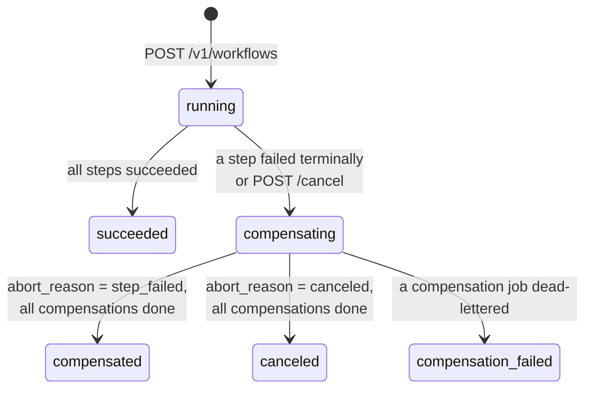

# TaskForge v0.6 design: workflow DAGs and saga compensation

- Date: 2026-11-08
- Status: Draft for owner review
- Roadmap item: v0.6 "Workflow DAGs and saga compensation"
- Builds on: v0.5 (PR #5), ADRs 0001–0011

## Intent

Through v0.5 every job is independent. Real backends often need several jobs
that depend on each other ("reserve stock, then charge card, then ship") and
need a defined way to undo completed work when a later step fails. v0.6 adds:

1. **Workflow DAGs.** A client submits one workflow: a set of steps, each an
   ordinary job kind, with dependencies between them. Steps run in parallel
   where the graph allows (fan-out) and wait for all their dependencies
   (fan-in).
2. **Saga compensation.** A step may declare a compensating job. If any step
   fails terminally, or the workflow is canceled, TaskForge stops starting new
   steps and runs the compensations of every step that already succeeded, in
   reverse dependency order.

**Why this version exists (owner's framing).** TaskForge is a portfolio piece
for backend / system-design interviewers and recruiters. They judge *evidence
of correctness*, not feature count. v0.6 therefore optimizes for precise
semantics, a small surface, and tests that prove the invariants under
concurrency and crashes. The headline artifact is a fault-injection test that
kills a worker in the middle of compensation and verifies the final state is
consistent.

## Owner decisions

| # | Topic | Decision |
| --- | --- | --- |
| 1 | Definition | Workflows are submitted as JSON through the HTTP API. No user code. |
| 2 | Data flow | **No result passing between steps.** Every step and compensation has a static payload fixed at submission. (Result mapping is a candidate for a later version.) |
| 3 | Compensation failure | Compensation jobs retry with the normal backoff; when one is dead-lettered the workflow ends `compensation_failed` and an operator decides. Compensations must be idempotent (at-least-once). |
| 4 | Engine | The workflow advances in the **same PostgreSQL transaction** as the job transition that caused it. NATS stays a hint only (ADR 0001, 0011). |
| 5 | Graph shape | DAG with fan-out/fan-in, **no conditional branches**. Workflow cancel is in scope. Redrive that resumes a workflow is **out of scope**. |
| 6 | Demo handlers | Allowed: add safe built-in handlers that fail on purpose so the saga can be demonstrated. |
| 7 | Audience | Interviewers/recruiters; prioritize a concurrency + fault-injection test against real PostgreSQL. |
| 8 | Process | Merge PR #5 (v0.5) first, then branch `feature/v0.6-workflows-saga` from `main`. |

## Goals

- Atomic advancement: no observable state where a step job is terminal but
  its workflow has not reacted, and vice versa.
- Each step's action job is created **exactly once**, and only after all of
  its dependencies succeeded, even when parallel dependencies finish at the
  same instant on different workers.
- Each succeeded step's compensation job is created exactly once, and only
  after the compensations of all succeeded steps that depend on it are done.
- Reuse the existing job pipeline unchanged for execution: claim, lease,
  fencing, retry, DLQ, outbox events, wake-ups.
- Same privacy rules: payloads and keys never leave the API or logs.
- Everything bounded: steps per workflow, request size, page sizes.

## Non-goals

- Passing results or outputs between steps; templating payloads.
- Conditional branches, loops, dynamic step creation, sub-workflows.
- Reusable/versioned workflow definitions (templates). Each submission is a
  self-contained run.
- Resuming a workflow from a redriven job.
- Workflow-level events on the bus (`workflow.*`). Job events for step jobs
  are emitted as today and gain a `workflow_id` field.
- Recurring workflows (schedules still create single jobs).
- Exactly-once side effects. Steps and compensations are at least once.

## Anti-goals (a failure even if it "works")

- A dependent step that starts before all of its dependencies succeeded.
- A step job or compensation job created twice for the same step.
- A compensation that runs before the compensations of the steps built on top
  of it.
- Workflow state advanced from NATS events or from any process memory.
- A workflow stuck forever in a non-terminal state with no non-terminal jobs.
- Deadlocks between workflow advancement and claim/recovery/cancel.

## Concepts and state machines

### Workflow



Terminal: `succeeded`, `compensated`, `canceled`, `compensation_failed`.
`compensating` is entered even when no step needs compensation; it then
finishes in the same transaction once nothing is in flight.

`abort_reason` is `step_failed` or `canceled`. On `step_failed` the workflow
records `failed_step` (step name) and `error_code` (the job's
`last_error_code`).

### Step (action side)

| Status | Meaning |
| --- | --- |
| `pending` | Waiting for dependencies. No job. |
| `dispatched` | Action job created (it may be queued, retrying, or running). |
| `succeeded` | Action job succeeded. |
| `failed` | Action job ended `failed` (dead-lettered). |
| `canceled` | Action job was still `queued` when the workflow aborted and was canceled. |
| `skipped` | Never dispatched because the workflow aborted. |

### Step (compensation side)

| Status | Meaning |
| --- | --- |
| `none` | Not needed (step did not succeed) or not yet decided. |
| `waiting` | Step succeeded with a compensation defined; waiting for dependents' compensations. |
| `dispatched` | Compensation job created. |
| `succeeded` | Compensation job succeeded. |
| `failed` | Compensation job dead-lettered. |
| `not_defined` | Step succeeded but declared no compensation (treated as done immediately). |

**Rules for abort:**

- `pending` steps become `skipped`.
- `dispatched` steps whose job is still `queued` are canceled in the abort
  transaction (job → `canceled`, step → `canceled`).
- `dispatched` steps whose job is running/retrying are **left to finish**. If
  that job later succeeds, the step becomes `succeeded` and is compensated
  like any other; if it fails, it is `failed` and not compensated.
- A failed step is never compensated: a failed action is assumed to have left
  no committed effect, or to be safe to repeat-undo via its own idempotency.
  This assumption is stated in the ADR and EVENTS/handler docs.

**Compensation order:** a succeeded step S may have its compensation
dispatched only when every *direct dependent* of S that succeeded has
compensation status `succeeded` or `not_defined`, and no direct dependent is
still `dispatched` on the action side (in flight). Independent branches
compensate in parallel. This is the reverse-DAG of the succeeded subgraph.

**Compensation failure:** when a compensation job is dead-lettered, the step
compensation becomes `failed` and the workflow becomes `compensation_failed`
immediately. No further compensations are dispatched; compensations already
in flight run to completion and record their outcome.

## API

### `POST /v1/workflows`

```json
{
  "label": "order-1042",
  "idempotency_key": "order-1042-v1",
  "steps": [
    {
      "name": "reserve",
      "kind": "demo.echo",
      "queue": "default",
      "priority": 0,
      "payload": {"message": "reserve"},
      "compensation": {"kind": "demo.echo", "payload": {"message": "release"}}
    },
    {
      "name": "charge",
      "kind": "demo.echo",
      "payload": {"message": "charge"},
      "depends_on": ["reserve"],
      "compensation": {"kind": "demo.echo", "payload": {"message": "refund"}}
    },
    {"name": "notify", "kind": "demo.echo", "payload": {"message": "email"}, "depends_on": ["reserve"]},
    {"name": "ship", "kind": "demo.fail", "payload": {}, "depends_on": ["charge", "notify"]}
  ]
}
```

Validation (all failures `400 VALIDATION_FAILED` unless noted):

- `steps`: 1..`TASKFORGE_WORKFLOW_MAX_STEPS` (default 32, max 100).
- Step `name`: `^[a-z0-9][a-z0-9._-]{0,63}$`, unique within the workflow.
- `kind`, `queue`, `priority`, `payload`: same rules as `POST /v1/jobs`.
  `compensation.queue` defaults to the step's queue; `compensation.priority`
  defaults to the step's priority.
- `depends_on`: names that exist in this workflow, no duplicates, no self
  reference; the whole graph must be acyclic (Kahn's algorithm; error message
  names one step on a cycle).
- `label`: optional, 1–128 printable characters; not unique; returned by GET.
- `idempotency_key`: same character rules as jobs, **globally** unique among
  workflows. Fingerprint = SHA-256 over the canonical normalized definition:
  label, steps sorted by name, payloads canonicalized, `depends_on` sorted,
  and defaults (queue, priority, compensation queue/priority) filled in. Same key + same fingerprint → `200` with the existing
  workflow; different fingerprint → `409 IDEMPOTENCY_CONFLICT`.
- Body limit: `TASKFORGE_WORKFLOW_MAX_BYTES` (default 256 KiB, max 4 MiB);
  each payload is still bounded by `TASKFORGE_JOB_PAYLOAD_MAX_BYTES`.
- Unknown `kind` is **not** rejected at submission (consistent with jobs); it
  fails at run time with `UNKNOWN_JOB_KIND` and triggers compensation.
- Delayed timing (`run_at`, `delay_seconds`) is not supported on steps.

Creation inserts the workflow, all steps, and the action jobs of every root
step (no dependencies) in **one transaction**. Response `201`:

### Workflow resource (`GET /v1/workflows/{id}`)

```json
{
  "id": "uuid",
  "label": "order-1042",
  "status": "compensating",
  "abort_reason": "step_failed",
  "failed_step": "ship",
  "error_code": "DEMO_FAILURE",
  "created_at": "…", "updated_at": "…", "completed_at": null,
  "steps": [
    {
      "name": "reserve", "kind": "demo.echo", "queue": "default",
      "depends_on": [], "status": "succeeded", "job_id": "uuid",
      "compensation": {"kind": "demo.echo", "status": "dispatched", "job_id": "uuid"}
    }
  ]
}
```

Never returned: step or compensation payloads, idempotency key, execution
keys. `compensation` is `null` for steps without one. Steps are ordered by
submission position.

### Other endpoints

| Endpoint | Behavior |
| --- | --- |
| `GET /v1/workflows?limit&cursor` | Newest first, keyset pagination (same cursor scheme as dead letters/schedules). Items omit `steps` and include `step_count`. |
| `POST /v1/workflows/{id}/cancel` | `running` → `compensating` with `abort_reason=canceled`; `200` with the workflow. Any other status → `409 WORKFLOW_STATE_CONFLICT`. Unknown → `404 WORKFLOW_NOT_FOUND`. |

### Changes to existing endpoints

- Job resource gains `workflow_id` and `workflow_role` (`action` or
  `compensation`), omitted for standalone jobs.
- `POST /v1/jobs/{id}/cancel` on a workflow-owned job → `409
  WORKFLOW_OWNED_JOB`. Workflows are canceled only as a whole.
- Redrive of a dead-lettered workflow job is allowed and creates a
  **standalone** job (no workflow link). The workflow's state is not changed.
  This is the operator's manual tool for `compensation_failed`.

## Data model (migration `000006_add_workflows.sql`)

```sql
CREATE TABLE workflows (
    id UUID PRIMARY KEY,
    label TEXT CHECK (label IS NULL OR char_length(label) BETWEEN 1 AND 128),
    status TEXT NOT NULL CHECK (status IN ('running','compensating','succeeded',
        'compensated','canceled','compensation_failed')),
    abort_reason TEXT CHECK (abort_reason IN ('step_failed','canceled')),
    failed_step TEXT,
    error_code TEXT CHECK (error_code IS NULL OR error_code ~ '^[A-Z][A-Z0-9_]{0,63}$'),
    idempotency_key TEXT UNIQUE CHECK (idempotency_key IS NULL OR char_length(idempotency_key) BETWEEN 1 AND 128),
    fingerprint BYTEA NOT NULL CHECK (octet_length(fingerprint) = 32),
    step_count SMALLINT NOT NULL CHECK (step_count BETWEEN 1 AND 100),
    -- Retry policy snapshot applied to every action and compensation job.
    max_attempts INTEGER NOT NULL, retry_initial_backoff_ms BIGINT NOT NULL,
    retry_max_backoff_ms BIGINT NOT NULL, retry_jitter_percent SMALLINT NOT NULL,
    created_at TIMESTAMPTZ NOT NULL DEFAULT NOW(),
    updated_at TIMESTAMPTZ NOT NULL DEFAULT NOW(),
    completed_at TIMESTAMPTZ,
    CHECK ((status IN ('running','succeeded')) = (abort_reason IS NULL))
);

CREATE TABLE workflow_steps (
    id BIGINT GENERATED ALWAYS AS IDENTITY PRIMARY KEY,
    workflow_id UUID NOT NULL REFERENCES workflows(id),
    position SMALLINT NOT NULL,
    name TEXT NOT NULL,
    queue TEXT NOT NULL, kind TEXT NOT NULL, priority SMALLINT NOT NULL,
    payload JSONB NOT NULL CHECK (jsonb_typeof(payload) = 'object'),
    depends_on TEXT[] NOT NULL DEFAULT '{}',
    remaining_dependencies SMALLINT NOT NULL CHECK (remaining_dependencies >= 0),
    status TEXT NOT NULL CHECK (status IN ('pending','dispatched','succeeded','failed','canceled','skipped')),
    job_id UUID UNIQUE REFERENCES jobs(id),
    compensation_queue TEXT, compensation_kind TEXT, compensation_priority SMALLINT,
    compensation_payload JSONB CHECK (compensation_payload IS NULL OR jsonb_typeof(compensation_payload) = 'object'),
    compensation_status TEXT NOT NULL DEFAULT 'none' CHECK (compensation_status IN
        ('none','waiting','dispatched','succeeded','failed','not_defined')),
    compensation_job_id UUID UNIQUE REFERENCES jobs(id),
    UNIQUE (workflow_id, name),
    UNIQUE (workflow_id, position),
    CHECK ((status = 'pending' OR status = 'skipped') = (job_id IS NULL)),
    CHECK ((compensation_kind IS NULL) = (compensation_payload IS NULL))
);

ALTER TABLE jobs
    ADD COLUMN workflow_id UUID REFERENCES workflows(id),
    ADD COLUMN workflow_step_id BIGINT REFERENCES workflow_steps(id),
    ADD COLUMN workflow_role TEXT CHECK (workflow_role IN ('action','compensation')),
    ADD CONSTRAINT jobs_workflow_link_check CHECK (
        (workflow_id IS NULL) = (workflow_step_id IS NULL)
        AND (workflow_id IS NULL) = (workflow_role IS NULL));

CREATE UNIQUE INDEX jobs_workflow_step_role_unique
    ON jobs (workflow_step_id, workflow_role) WHERE workflow_step_id IS NOT NULL;
CREATE INDEX workflows_list_index ON workflows (created_at DESC, id DESC);
CREATE INDEX workflow_steps_workflow_index ON workflow_steps (workflow_id, position);
```

The partial unique index `jobs_workflow_step_role_unique` is the database
backstop for "exactly one action job and at most one compensation job per
step". The column details above are the intended shape; the builder may
adjust names and add indexes as long as the invariants hold.

The outbox trigger (`taskforge_record_job_event`) is updated to add
`workflow_id` to the job snapshot. This is an additive field; event body
`version` stays `1`. `EVENTS.md` documents it.

## Engine: advancing a workflow

### Where it runs

A single Go function in `internal/store/postgres`, called **inside the
existing transaction** of every path that moves a workflow-owned job to a
terminal state:

| Path | Terminal transition |
| --- | --- |
| `finishJob` (via `CompleteJob`) | `running → succeeded` |
| `finalizeFailure`, terminal branch (via `FailJob` and `RecoverExpiredJobs`) | `running → failed` |
| workflow abort (inside the engine itself) | `queued → canceled` |

`CancelQueuedJob` rejects workflow-owned jobs, so it is not an entry point.
Retry transitions (`running → queued`) do not involve the engine.

Rationale for Go over a PL/pgSQL trigger (builder's call): there are only two
external entry points, the DAG logic is non-trivial and far easier to read and
unit-test in Go, and interviewers can follow it. The risk "a future path forgets
to call it" is covered by an invariant check run at the end of every workflow
integration test (no terminal workflow job whose step status disagrees with
its job status).

### Lock order (deadlock freedom)

Every transaction that touches workflow state takes locks in this order:

1. job row(s) (`jobs`), lowest `id` first when more than one,
2. the `workflows` row (`FOR UPDATE`),
3. `workflow_steps` rows of that workflow.

The worker paths already hold the job row when they call the engine. The
cancel endpoint locks the workflow's currently `queued` jobs first
(`SELECT … FROM jobs WHERE workflow_id=$1 AND status='queued' ORDER BY id FOR
UPDATE`), then the workflow row, then re-checks state. The engine never locks
a job row after the workflow row, except jobs it is inserting (new rows, no
contention) and queued jobs it cancels during abort — which it must lock with
`FOR UPDATE SKIP LOCKED`; a queued job that is concurrently being claimed is
skipped and treated as in flight (it will reach the engine through its own
terminal transition later).

Locking the workflow row serializes all advancement of one workflow, which
makes the fan-in counter (`remaining_dependencies`) safe without further
tricks.

**Several workflows in one transaction.** `RecoverExpiredJobs` can finalize
jobs of different workflows in one batch. Two concurrent recovery batches that
lock workflow rows in different orders would deadlock. Therefore, when a
transaction advances more than one workflow, it first locks all involved
`workflows` rows in ascending `id` order, then runs the engine per job.

**Queued jobs skipped during abort.** A queued step job that is locked by a
concurrent claim (and therefore skipped by `SKIP LOCKED`) stays alive: it is
claimed, runs, and reaches the engine through its own terminal transition. If
it succeeds it is compensated like any other succeeded step. This is correct
under the saga rules, only slightly wasteful, and is documented.

### Algorithm (pseudo-code)

```text
onJobTerminal(tx, job):                    # job row already locked and updated
  if job.workflow_id is null: return
  wf    = lock workflow
  step  = load step(job.workflow_step_id)
  if job.role == action:
     step.status = succeeded | failed (from job status)
     if succeeded:
        step.compensation_status = waiting if compensation defined else not_defined
        if wf.status == running:
           for d in direct dependents(step): d.remaining_dependencies -= 1
                                             if 0 and d.status == pending: dispatch(d)
     if failed and wf.status == running:
        abort(wf, step_failed, step.name, job.last_error_code)
  else (compensation):
     step.compensation_status = succeeded | failed
     if failed and wf.status == compensating: wf.status = compensation_failed; completed_at
  settle(wf)

abort(wf, reason, ...):
  wf.status = compensating; record reason/failed_step/error_code
  pending steps            -> skipped
  dispatched steps whose job is queued (lock SKIP LOCKED) -> job canceled, step canceled

settle(wf):
  if wf.status == running and all steps succeeded: wf.status = succeeded; done
  if wf.status == compensating:
     for each step with compensation_status == waiting, in any order:
        if all succeeded direct dependents have compensation in (succeeded, not_defined)
           and no direct dependent has action status dispatched:
           dispatch_compensation(step)
     if no step is action-dispatched and no step is waiting/compensation-dispatched:
        wf.status = compensated (step_failed) or canceled (canceled); completed_at
```

`dispatch` inserts a job with `workflow_role='action'`, the step's queue,
kind, priority and payload, a fresh execution key, the workflow's retry
snapshot, `available_at = NOW()`, and no submission idempotency key; then sets
`step.job_id`, `status = dispatched`. `dispatch_compensation` is the same with
`workflow_role='compensation'` and `compensation_job_id`.

Note the `settle` fixpoint: dispatching a compensation never completes
anything synchronously, so a single pass is enough.

### Handler-visible metadata

`job.Execution` gains an optional `Workflow *WorkflowContext`:

```go
type WorkflowContext struct {
    WorkflowID              string
    Step                    string
    Role                    string // "action" | "compensation"
    CompensatesJobID        string // compensation only
    CompensatesExecutionKey string // compensation only: the action job's execution key
}
```

`CompensatesExecutionKey` lets a compensation tell its downstream "undo the
effect created with key K" — the natural partner of ADR 0008. It is passed to
handlers only, never returned by the API or logged. Claim loads it with one
extra join when `workflow_id` is not null.

## Demo handlers (registry)

All bounded, no I/O, safe to run anywhere:

| Kind | Payload | Behavior |
| --- | --- | --- |
| `demo.echo` | `{"message": string}` | Unchanged. |
| `demo.fail` | `{"code"?: "UPPER_CODE"}` | Always fails **permanently** with `code` or `DEMO_FAILURE`. |
| `demo.flaky` | `{"fail_attempts": 0..10}` | Fails **retryably** with `DEMO_TRANSIENT` while `Execution.Attempt <= fail_attempts`, then succeeds. |
| `demo.sleep` | `{"ms": 0..60000}` | Sleeps (respecting `ctx`) then succeeds. Used to keep a step in flight during abort and crash tests. |

## Configuration (new)

| Variable | Default | Bounds | Used by |
| --- | --- | --- | --- |
| `TASKFORGE_WORKFLOW_MAX_STEPS` | `32` | `1..100` | API |
| `TASKFORGE_WORKFLOW_MAX_BYTES` | `262144` | `1024..4194304` | API |
| `TASKFORGE_WORKFLOW_PAGE_SIZE` | `50` | `1..100` | API |

The retry policy used for workflow jobs is the existing `TASKFORGE_JOB_*` /
`TASKFORGE_RETRY_*` configuration of the API process, snapshotted into the
`workflows` row at creation, so jobs later created by workers use the same
policy.

## Testing (the portfolio centerpiece)

### Unit

- Graph validation: duplicates, unknown deps, self-loops, cycles (with a
  named step), max steps, canonical fingerprint stability under reordering.
- The pure "what to dispatch next" decision functions, written so they can be
  tested without a database (input: step states; output: dispatch set /
  terminal status).
- Demo handlers, API validation and privacy (no payloads in responses).

### PostgreSQL integration (real database)

Scenarios, each ending with `assertWorkflowInvariants` (below):

1. Linear success A→B→C; diamond A→{B,C}→D success.
2. Failure in the middle: diamond where D fails → B and C compensated in
   parallel, then A; workflow `compensated`; D not compensated.
3. Step without compensation inside the reverse order (`not_defined`).
4. Retryable step (`demo.flaky`) succeeds after retries; no extra jobs.
5. Compensation fails permanently → `compensation_failed`, no further
   compensations dispatched, in-flight ones still recorded.
6. Cancel while a step is running (`demo.sleep`): queued siblings canceled,
   pending skipped, running step finishes and is then compensated; workflow
   `canceled`.
7. Cancel races step completion: both orders end consistent; cancel after
   terminal → `409`.
8. Idempotent submission: concurrent identical submissions → one workflow;
   conflicting → `409`.
9. `POST /v1/jobs/{id}/cancel` on a workflow job → `409`; redrive creates a
   standalone job and leaves the workflow unchanged.
10. **Fan-in race:** 16 parallel roots → one sink; complete all 16 from 16
    goroutines simultaneously; the sink job exists exactly once.
11. **Crash during compensation (fault injection):** a worker claims a
    compensation job and "dies" (stops heartbeating, writes nothing); the
    lease expires; recovery requeues it with `LEASE_EXPIRED`; a second worker
    completes it. Assert: one compensation job row, two attempt rows (one
    `abandoned`), both executions saw the same `CompensatesExecutionKey`,
    workflow ends `compensated`, earlier steps compensated only after it.
12. **Randomized soak (property test):** N random DAGs (seeded, reproducible,
    up to 12 steps), random mix of `echo/fail/flaky/sleep`, random cancels, 4
    concurrent in-process workers with short leases and injected "crashes";
    run until all workflows are terminal (bounded timeout); check invariants
    for every workflow. The seed is printed on failure.
13. Migration upgrade from v0.5 with live data.

`assertWorkflowInvariants(workflowID)` checks, from the database only:

- I1 every step has ≤ 1 action job and ≤ 1 compensation job (also enforced by index).
- I2 a step's action job was created no earlier than every dependency's job
  succeeded (`jobs.created_at >= dependency completed_at`; both come from
  `NOW()`, which is equal inside one transaction).
- I3 `succeeded` ⇒ all steps `succeeded`, no compensation jobs.
- I4 `compensated`/`canceled` ⇒ every `succeeded` step has compensation
  `succeeded` or `not_defined`; no workflow job is `queued` or `running`.
- I5 a compensation job of S was created after the compensation of every
  succeeded direct dependent of S completed.
- I6 terminal workflow ⇒ no non-terminal workflow jobs, and `completed_at` set.
- I7 `compensation_failed` ⇒ at least one compensation is `failed` and its job
  is dead-lettered.
- I8 every step status agrees with its job status (the "forgotten path" guard).

### End to end

`POST /v1/workflows` through the HTTP handler, real worker runner, real
database: the order example above ends `compensated` with the expected
sequence of job events in the outbox (`job.succeeded` for reserve/charge/notify,
`job.failed` for ship, then compensation jobs `job.queued … job.succeeded`).

## Documentation deliverables

- ADR 0012: workflows advance in the job's transaction; lock order; reverse-DAG
  compensation; no result passing; redrive detaches.
- New `docs/WORKFLOWS.md`: concepts, state machines, a worked example with
  diagrams, guarantees and non-guarantees, how to write compensations.
- Updates: README (feature + roadmap status), CURRENT_STATE, PRD, DESIGN,
  DATA_MODEL, API, EVENTS (`workflow_id` field), CONFIGURATION,
  OPERATIONS (new failure codes, `compensation_failed` runbook), TESTING
  (invariants and the soak test), `.env.example`, ADR index, and CONTRIBUTING
  (remove "must not add workflow DAGs").

## Implementation order

1. Merge PR #5; branch from `main`.
2. Migration 6 + outbox trigger update + upgrade test.
3. Domain: workflow submission validation, canonical fingerprint, pure
   next-step/compensation decision functions (unit tested).
4. Store: create workflow (with root dispatch), get/list, engine hook in
   `finishJob` and `finalizeFailure`, abort/cancel, claim loads workflow
   context, cancel-guard on `CancelQueuedJob`.
5. Demo handlers.
6. HTTP endpoints and config.
7. Integration scenarios 1–11, then the soak test 12.
8. Docs and ADR.

## Calls made by the builder (owner: please check)

- Each submission is a self-contained run; no reusable templates.
- Workflow idempotency key is global (workflows have no queue).
- Engine in Go, called from the two terminal paths, guarded by invariant I8;
  not a PL/pgSQL trigger.
- Running steps are allowed to finish during abort and are compensated if they
  succeed.
- Failed steps are never compensated.
- On `compensation_failed`, stop dispatching further compensations.
- Canceling individual workflow jobs is rejected; only whole-workflow cancel.
- Redrive of a workflow job creates a standalone job.
- Retry policy snapshotted on the workflow so worker-created jobs use the
  API's policy.
- Four demo handlers: `echo`, `fail`, `flaky`, `sleep`.
- Job events gain `workflow_id`; no `workflow.*` events in v0.6.
- Limits: 32 steps, 256 KiB body by default.
- A queued step job that is mid-claim during abort is allowed to run and is
  compensated if it succeeds, rather than blocking the abort.
- New public error codes: `WORKFLOW_NOT_FOUND`, `WORKFLOW_STATE_CONFLICT`,
  `WORKFLOW_OWNED_JOB`; new job failure codes `DEMO_FAILURE`, `DEMO_TRANSIENT`.
